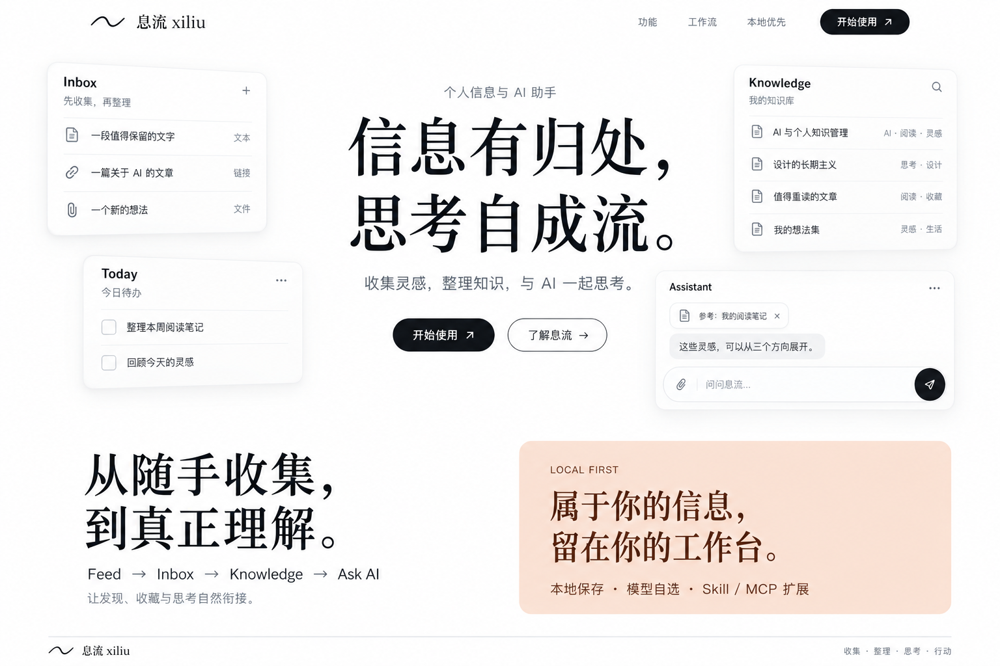

# 息流 · xiliu


[简体中文](README.zh-CN.md) · [English](README.en.md)

[在线体验游客演示](https://sodaa1.github.io/xiliu/#/today) · 免安装、免 API Key，使用示例数据和演示回复。

*应用主页截图（已启用内置背景），可在设置中切换主页背景。*

**信息有归处，思考自成流。** 息流是本地优先的个人信息与 AI 助手，把 Feed、Inbox、Knowledge、Assistant 和 Today 连接成从发现到行动的信息流。

当前版本：**0.4.5**。React 界面和 FastAPI 业务层复用 Runtime / LangGraph；Windows 桌面使用 Tauri 2。资料与会话保存在本机，启用模型或联网工具时，对应请求会发送至用户配置的服务。

## 完整网页版部署包

完整版支持注册登录、独立资料空间、自带模型 API，以及可选的每账号累计 5 次公共模型试用。免登录游客入口保留示例数据和演示回复。

按 [Docker 部署指南](docs/CLOUD_WEB_DEPLOYMENT.md) 自行部署，账号资料保存在服务器持久化卷中；备份和账号恢复见 [运维说明](docs/cloud-operations.md)。目前提供可部署源码包，尚未上线公共完整版服务；上方 GitHub Pages 链接仍为游客演示。桌面账号登录和双向数据同步留待后续实现。

云端不开放本机文件、进程、Skill / MCP 和公共搜索凭据；AI Hot 与联网搜索暂不可用。Windows 0.4.5 安装包仍为本地桌面版本。

## 最近更新 · 2026-10-23

- 统一六个页面的图标侧栏和角落控件，移除重复的顶部搜索与空白；首页独有的主题切换保持一致。
- Inbox 与资讯默认采用紧凑横排卡片，打开后切为左侧列表与右侧阅读面；阅读面贴齐右边和底部，切换内容尺寸保持稳定。
- 知识库保留原有文件夹卡片，增加标签分类和最近资料入口；桌面顶部工具区约占四分之一，给资料留出更多空间。
- 保留现有收集、编辑、归档、搜索、引用提问及原件下载接口。此次改进随主干源码提供，不代表已发布的 Windows 安装包或在线演示已同步更新。

界面效果与兼容性记录见 [本次集成验证](docs/ui-redesign-v2/integration.md)。旧版本历史见 [GitHub Releases](https://github.com/sodaa1/xiliu/releases)。

## 功能与工作流

**发现 → 收集 → 整理 → 提问 → 行动**

| 模块 | 功能 |
| --- | --- |
| Feed | AI Hot、GitHub Top 5、来源状态、收藏与 Ask AI。 |
| Inbox | 收集文字、URL 和文件；保留来源与原件，后台提取、可选 AI 整理、编辑与归类。 |
| Knowledge | 标签与规则文件夹、中文混合检索、原资料引用、可选 embedding。 |
| Assistant | 多会话、Markdown、模型切换、思考过程、本轮参考、停止回复、Skill / MCP。 |
| Today | 资讯与待办聚合，创建、编辑与完成任务。 |
| Settings | 模型、个人、外观、数据与自动任务；浅色 / 深色 / 跟随系统、减少动态效果。 |

## Windows 安装

从 [GitHub Release v0.4.5](https://github.com/sodaa1/xiliu/releases/tag/v0.4.5) 下载 `Xiliu-0.4.5-x64-setup.exe` 与 SHA256 校验文件。安装包作为 Release 附件发布，不存入 Git 源码。

1. 双击安装包，使用中文向导安装并启动「息流」。无需另装 Python、Node.js 或 Rust。
2. 首次启动在设置中自行填写模型提供商、API 地址、模型名称和 API Key。安装包不包含开发者密钥、个人模型配置、数据库、测试或项目文档。
3. 将资料收集到 Inbox，归类到 Knowledge，再在 Assistant 中引用资料提问。

支持 Windows x64，需要 WebView2；缺少时安装引导程序需联网下载。当前安装包未签名。桌面资料位于 `%APPDATA%\io.xiliu.desktop`，开发 Web 默认使用项目 `.xiliu/`。升级前退出应用并备份完整数据目录，无需为升级删除已有资料。

构建与验收边界见 [Windows 交付记录](docs/WINDOWS_RELEASE.md) 和 [桌面说明](desktop/README.md)。

## 从源码运行

需要 Python 3.12+、uv、Node.js / npm，在项目根目录执行：

```powershell
uv sync --dev
cd web
npm ci
npm run build
cd ..
uv run xiliu web --open
```

Windows 可双击 `start-xiliu.bat`。默认 `http://127.0.0.1:8765`。开发前端执行 `npm run dev`，另一个终端在项目根目录执行 `uv run xiliu web`。CLI 命令见 `uv run xiliu --help`。

Windows 源码打包还需要 Rust MSVC 与 Microsoft C++ Build Tools / Windows SDK：

```powershell
powershell -ExecutionPolicy Bypass -File scripts/build-windows.ps1
```

脚本依次构建前端、冻结服务、Tauri / NSIS，导出版本对应的 `.exe` 和 SHA256 到 `dist/`。

## 模型与联网配置

通过设置页填写模型配置，或复制 `.env.example` 为本地 `.env`。不要提交真实密钥。

| 配置项 | 用途 |
| --- | --- |
| `XILIU_PROVIDER` | 模型提供商。 |
| `XILIU_BASE_URL` | 模型兼容 API 地址。 |
| `XILIU_MODEL` | 对话模型名称。 |
| `XILIU_API_KEY` | 模型密钥；接口不回显明文。 |
| `XILIU_DATA_DIR` | 数据目录。 |
| `XILIU_EMBEDDING_MODEL` | 可选专用 embedding 模型；留空使用本地检索。 |
| `TAVILY_API_KEY` | Search 工具使用的搜索服务密钥，与对话模型 API 分开。 |

对话模型、网页资料识别、AIHot MCP 与 Search 工具是不同调用链；其中一个能联网，不代表其他服务已配置。MCP 可按服务需要提供各自运行环境和配置。完整变量见 [.env.example](.env.example)。

## 内核与 RAG

**Fast** 处理轻量聊天和简单本地查询；**Standard** 使用计划、工具执行与有界验证；**Deep** 按需组织 Todo 与子 Agent。API 的可选 `mode` 参数支持指定模式，省略时自动路由；沿用 NDJSON 流和 Gateway 权限链。

工具结果统一为 Evidence，进入 GraphState、Memory 和 Verifier。RAG 与 Knowledge 共用 SQLite；资料变化进入持久化后台队列，查询不触发全量索引，向量只重算变化片段。默认全文与元数据检索不需要向量服务；首次 RAG 迁移保留 `app.pre-rag.sqlite3` 备份。

数据目录 `agents/` 提供 `rag`、`research`、`code` 模板，子 Agent 权限按父级范围收窄。详见 [0.2 内核交付](docs/XILIU_02_KERNEL_RAG.md)。

## 验证与当前边界

2026-10-23 本次 UI 集成验证：主干后端 **931 passed / 1 skipped**，前端 **258 passed**；Lint、正式构建与 1092 项界面静态覆盖审计通过。另对本地尚未提交的后端改动运行了 38 项相关接口测试，全部通过；这些后端改动不包含在此次 UI 提交中。完整结果和验证边界见 [集成记录](docs/ui-redesign-v2/integration.md)。

```powershell
uv run python -m pytest
uv run ruff check src/xiliu
uv run pyright src/xiliu
uv run python scripts/verify_kernel_rag.py
cd web
npm test -- --run
npm run lint
npm run build
```

测试代码随源码维护；开发日志、临时资料和测试工具不进入安装包。离线证明脚本使用假模型，不需要真实供应商密钥。

- PDF / DOCX 可提取文字，扫描件暂不做 OCR；保存 URL 不等于自动抓取全文。
- 停止回复不撤销已完成的写入，也不提供断点继续；同步外部请求可能等待下一段流数据或超时后才释放。
- 节点内部工具批次崩溃时尚不提供逐工具 exactly-once 恢复；知识库面向单用户，工具权限不等于系统网络隔离。
- 桌面包不携带开发解释器、pytest、ruff；Code Agent 的 Python 脚本与测试执行请使用源码开发环境。
- 0.3 SDK / Graph / HTTP 链路用本地虚拟 API 验证，没有使用用户真实密钥；原生桌面窗口拖入和全新设备的 WebView2 下载流程尚未进行交互式验收。

## 文档与来源

[中文文档](docs/README.zh-CN.md) · [English documentation](docs/README.en.md) · [开发进展](docs/DEVELOPMENT_PROCESS.md) · [English progress](docs/DEVELOPMENT_PROCESS.en.md) · [架构](docs/ARCHITECTURE.md) · [阶段记录](docs/PHASES.md)

源内核来自 [sodaa1/xiliumini](https://github.com/sodaa1/xiliumini)，基线 `6d3689583f93b3fafd6381b2b65c31d9613464e5`；本项目品牌、包名、CLI 与配置使用 `xiliu`。

产品介绍网站源码、脚本与设计资料位于 [`docs/web/`](docs/web/README.md)，应用构建继续提供 `/intro/` 入口。公开介绍：[息流 · xiliu](https://933693.xyz/projects/xiliu/)。

## 产品介绍概念图



*上图为产品介绍页的视觉概念，卡片内容为设计示意。*
