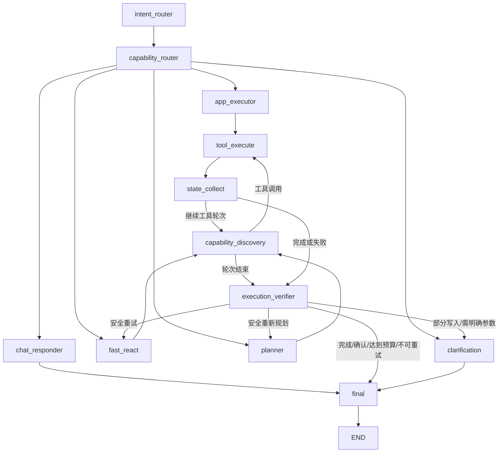

# 息流 0.4 — Agent Graph v2 架构

FastAPI 托管 `web/dist`，React 负责界面。Desktop Assistant、CLI 和 Automation Runner
统一进入 `Runtime`，由 `graph/workflow.py` 的唯一 LangGraph 执行。Skill、MCP、
SubAgent、RAG、App Action 均保留原有权限与持久化边界。

Direct Action 的工具规则语义匹配复用 `MemoryManager.assemble` 的分层记忆，包括当前有效
多轮对话和压缩摘要。会话中已验证的 App 对象回执另以 `object_memory` 保留身份及来源，
跨压缩可追溯、清除会话后失效。执行器可据此解析隔多轮的指代和范围补充，随后仍读取
数据库当前状态并经过原权限/确认检查；历史记录不作为新的操作授权。

带注释的当前架构树、运行循环和分阶段开发过程见 [DEVELOPMENT_PROCESS.md](DEVELOPMENT_PROCESS.md)。

0.2 的三模式 Graph 已迁移为两层路由和 12 个真实节点；0.3 的应用服务、多会话与取消能力继续复用。
逐阶段审计和测试记录见 [Graph v2 实施记录](architecture/graph-v2/implementation.md)，
验收结果与修改清单见 [Graph v2 验证报告](architecture/graph-v2/validation.md)。
网页反馈后的模型隔离、语义规则匹配与真实 API 验收见
[网页修复验收报告](architecture/graph-v2/web-acceptance-results.md)。

## 唯一工作流与两层路由

Intent Router 内部按 Command Adapter → Rule Matcher → 可选本地 Embedding Matcher
→ 严格 JSON LLM Classifier 识别，输出 intent/domain/action/complexity/source/
preferred_capability/confidence。未配置本地 matcher 时进入 LLM fallback，不隐式调用 embedding API。
Capability Router 选择 Chat、明确 App Action、最多五次工具调用的 Fast ReAct、Planner 或澄清。
没有 standard/deep/fast 执行模式或 Supervisor 转发节点。

以上恰好 12 个注册节点。附带目标图中的 Registry、GraphState 框分别落实为
capability_discovery、state_collect；chat/final、clarification 和有界工具轮次的边明确补齐。
START 默认进入 intent_router，恢复可进入任一有效节点；这些恢复边在精确拓扑测试中检查。
`/clear`、`/compress` 由入口的 CommandControl 更新会话，不进入 Agent 循环。
`/skill`、`/mcp` 进入图并约束所选能力，不通过 App 快路径转发。

## State、能力、验证与恢复

GraphState 承载结构化 intent、capability_candidates、tool_events、evidence、results、
execution_ids、execution_result，及可序列化的待执行调用与消息。tool_events/evidence/
agent_results 使用 ID 去重 reducer；state_collect 采集真实回执、子执行证据和持久化 Todo。
零命中查询会清除当前 retrieval_hits，不复用旧查询的命中结果。

CapabilityManager 同时登记单个 App Action、builtin、Skill、MCP、Agent 元数据。App Action
元数据沿用已有 permission/confirmation_policy；发现能力不会授予权限。所有实际调用经
ExecutionGateway → Policy/Hook → AppDispatcher 或原有工具。AppDispatcher 仍负责严格参数、
人工确认、revision、幂等请求和数据库回读，业务服务未另写一套。

Direct Action 检查回执及最终对象数据库状态。Fast 检查真实执行失败、目标所需效果、文件读回、
来源和执行预算。Planner 在这些检查之后核对计划、Todo、研究证据、测试时序，并请求模型
基于实际证据判断目标。读取、加载 Skill、查询自动化列表不能冒充写入；SQL 文件不能冒充
已建立的数据库。历史读回执和被后续合法写入覆盖的中间状态保留为证据，仅最终写入与
未被覆盖的批量对象接受当前数据库回读。

执行身份 execution_run_id 跨恢复固定，与每次 trace ID 分离。App 执行与模型待调用使用
稳定 request_id；收到回执时停止后恢复会重放保存的回执，不重复写入。已经成功 App 写入
之后的失败进入澄清，不自动重做业务操作。恢复仍重新执行权限校验，后台身份不能重放
被禁止的写操作。Checkpoint 支持全部新节点，并将旧 mode/字符串 intent 与旧 verifier
节点迁移为新 State；不恢复旧执行器。严格 JSON、类型、工作区和 Git 快照校验继续生效。

Desktop streaming 保留 Progress/Planner/Verifier/Final 事件契约，FinalEvent 位于检查点进度之后。
网页收到 Final 后先排空 Runtime 的终结阶段，确保 Checkpoint/Trace 已完成再发布最终回答。
Automation Runner 保留必须经过 VerifierEvent 才能标记成功的规则；后台权限及报告/数据库
持久化沿用原实现。CLI 控制命令更新真实会话历史，压缩保留摘要。

## 服务与界面

模型设置采用独立连接 ID：预设为 provider:model，自定义连接基于地址及模型生成稳定 ID。
OpenAI、DeepSeek Flash/Pro、MiMo V2.6 Pro/Flash 可并列配置；会话覆盖只选择连接，不改全局默认。
旧裸模型名仍按当前厂商解析到其独立连接。修改正在使用的默认连接时同步 CLI 兼容字段，
其他连接保存不会切换默认。密钥只写本机 `.env`，响应仅含 api_key_set，不回显原文。
自定义接口当前支持 OpenAI 兼容的 Chat Completions 协议，不自动添加其他厂商的专属参数。

Direct Action 在已有规则读取位置进行一次模型语义匹配，提供当前权限允许的 Action 描述、
domain、side_effect、参数 schema、权限及确认规则；名称、选择器和待保存原文必须来自用户输入。
DeepSeek/MiMo 的这次结构化匹配禁用思考，以兼容强制工具选择；不修改共享模型实例。
Fast/Planner 在原有模型调用前提供当前路径的清单并匹配语义，保留原循环和预算。
清单作为临时模型上下文，不在每轮向历史重复追加。Chat 不接收工具规则。

Agent 的 Inbox 导入持久化 auto_archive=false，后台可以整理元数据但不能擅自改变用户目的地。
界面导入仍保持原自动分类行为，重试读取持久化选择。导入回执核对原文、目的地和 revision，
允许同 revision 的后台元数据更新，人工修改仍使旧回执失效。
仅单调用的 TODO pending→completed 拒绝可返回同一有限循环供模型修正；失败回执仍保留，
权限、确认、其他工具失败的停止规则不变。

思考面板默认展示中文实际执行步骤，模型返回的原文折叠展示，不做额外模型总结。
官方 OpenAI 的支持模型请求 Responses reasoning summary 并转发可公开摘要；
DeepSeek/MiMo 保留 reasoning_content 流及工具轮次历史。未返回摘要时只显示真实步骤。

- `api/routes/content.py` 与 `services/content.py`：Inbox / Knowledge、Markdown、原件下载、中文 FTS5 检索。
- `api/routes/workspace.py`：Feed、Tasks、Today、自动任务及数据设置；服务分别位于 `services/feed.py`、`tasks.py`、`automations.py`。
- `api/app.py`：服务挂载、静态文件、调度生命周期。对话与模型 API 保留原路由。
- `web/src/app/App.tsx`：路由外 ChatProvider、可折叠导航、助手/Feed/设置快捷入口。设置内嵌自动化；Inbox 共用内容组件，Knowledge 增加规则文件夹页。`lib/preferences.ts` 与 `desktop/bridge.ts` 管理外观和桌面偏好备份。
- `web/src/lib/workspace-api.ts`：内容和工作台接口；`lib/api.ts`：对话和 NDJSON。响应式样式位于 `styles/`。

## 数据

`app.sqlite3` 保存 Web 会话、内容索引、FTS5、资讯缓存及 Save 映射、待办。内容位于 `content/<uuid>/item.md`；原件使用固定磁盘名称，保留原文件名元信息。Inbox 移到 Knowledge 只更新状态和 Markdown，不复制附件。长词用 FTS5 trigram，短中文词用转义 LIKE。

`automation.sqlite3` 和 `automation-reports/` 由现有 AutomationStore / Runner 使用。Web lifespan 启动现有 AutomationScheduler，每 10 秒续租与同步任务；同目录有其他调度 owner 时保留其所有权。任务执行时读取最新模型设置，完成后关闭 Runtime。Today 汇总已有服务，不另建业务数据库。

## 对话与外部信息

ChatProvider 在页面路由外保持请求；切页与弹窗不会卸载执行状态。用户可显式停止，思考过程和耗时随消息保存。`/clear` 删除当前消息和摘要，保留会话及模型选择。

## Knowledge 与桌面增量

`api/services/inbox.py` 管理持久化后台导入与单 worker，`knowledge.py` 提供纯标签规则与文件夹，`extract_text.py` 提取文本/PDF/DOCX。人工修改推进 revision，过期模型结果不能覆盖；`processing.json` 保存恢复所需的 AI 选择。Markdown 和文件夹快照仍为恢复来源，SQLite 保存关联索引与任务状态。

`retrieval.py` 桥接共享 `rag/` 服务，提供标签快路径与 FTS/中文/元数据混合检索；持久化后台作业索引资料片段，查询不全量重建，可选 embedding 仅重算变化片段。`tools/knowledge_search.py` 经既有 Gateway 与 `knowledge.read` Policy 接入 Agent，引用链接回到 Knowledge 资料。未配置专用 embedding 模型时不调用向量服务。`tools/app_tools.py` 复用 Inbox 的真实导入、查询与归类服务，分类保存带 revision 校验。

`desktop/server.py` 是 PyInstaller 服务入口，资源包含生产前端和公开 MCP 默认配置。Tauri 管理窗口、ready 检查、自有子进程、日志和本机偏好；退出请求与管道 EOF 进入 FastAPI lifespan，超时仅回收自有 Child。0.2 / 0.3 Windows 安装包已生成；不同版本的实际安装和行为验收以 [Windows 交付记录](WINDOWS_RELEASE.md) 为准。

Web 传入 `include_workspace_history=False`，SQLite 提供会话上下文；CLI / TUI 保留 True。Ask AI 参考只加入本轮请求，使用数据标签和 JSON 编码，不写入后续历史。界面允许移除参考并标明长文本截取。文件上传保留原件，不做 OCR 或附件正文提取。

AI Hot 经 MCPManager → ExecutionGateway → Policy / Hook 调用 `aihot_get_latest`。GitHub Top 5 来自官方公开 Trending 页面。失败保留缓存，分别显示来源状态；前端不调用外部模型或连接。

## 启动与验证

启动页位于 `features/launch/`，Canvas 绘制银河粒子旋转与向心流动，开场 2.6 秒后仍持续动画。绘制上限 30 fps、像素比上限 1.5，页面隐藏时暂停；reduced-motion 使用静态最终画面。Enter 样式单独限定作用域，离开启动页时清理绘制与监听器。

Windows 使用 `start-xiliu.bat`，或 `xiliu web --open`。配置与运行数据忽略，不进入代码改动。完整验收见 [COMPLETION_REVIEW.md](COMPLETION_REVIEW.md)，阶段记录见 [PHASES.md](PHASES.md)。

### 未完成请求的多轮补充

会话记忆包含 pending_requests，来自真实会话的澄清/确认状态；保留原始请求、补充和问题，跨压缩保存，清空会话后失效。路由先由模型区分参数补充与独立新请求；不会由补充内容中的待办/文件关键词覆盖待创建自动任务的领域。读取不完成请求，验证写入/确认后清除。自动任务创建使用单个 automations.create 原子写入，名称、时间、时区、提示内容统一解析，保留界面确认和数据库核验。
