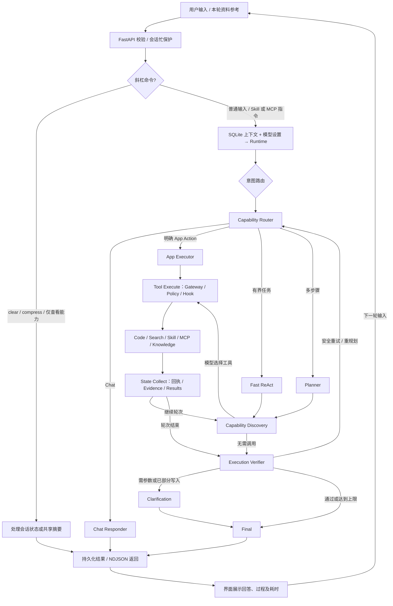

# 息流开发过程与阶段进展

更新：2026-10-09，当前主干版本 **0.3.0**。[English](DEVELOPMENT_PROCESS.en.md)。本文记录项目如何从原 Agent 内核扩展为 Web 工作台，以及当前实现边界；安装和启动说明见 [中文版](README.zh-CN.md) / [English](README.en.md)。

## 最新状态：0.3 主干与独立修复

0.3 已在 0.2 三模式内核和共享 RAG 基础上完成应用写入工具、多会话并行、按会话停止回复、可调整侧栏 / 输入框、思考流保留、模型连接错误直返，以及 AIHot 默认 MCP 配置。具体问题、修改和验收边界见 [0.3 修复记录](XILIU_03_FIXES.md)。

Agent 现在复用 Inbox 的实际导入、查询和归类服务；多个 URL 分别创建卡片，用户明确要求保存时可保存未匹配文件夹的资料。分类和保存共享 revision 校验，避免覆盖等待期间的人工修改。聊天运行状态与取消控制器按会话 ID 保存，停止只作用于所选聊天，已完成写入不回滚。布局支持拖动、键盘操作与浏览器本机保存。

当前 Windows 产物为 `dist/Xiliu-0.3.0-x64-setup.exe`（38,696,736 字节，约 36.90 MiB）；校验文件同目录保存。模型 API 由用户自行配置，公开 AIHot 默认资源随包分发；未包含开发者密钥、测试、项目文档或用户资料。0.2 的实际安装 / 窗口生命周期记录作为历史证据保留，不能替代 0.3 新行为的交互式验收。

本次主干上传前重新验证：

| 检查 | 实际结果 |
| --- | --- |
| 后端回归 | 124 passed / 1 skipped，20.82 秒；唯一跳过为 Windows 符号链接权限不足的既有用例。 |
| 前端回归 | 10 个文件、33 passed。 |
| Python 静态检查 | Ruff 全部通过；Pyright 0 errors / 0 warnings。 |
| 前端静态检查与构建 | ESLint 与 TypeScript / Vite 生产构建通过。 |
| 既有 0.3 来源与冻结服务证据 | ready 令牌、未配置密钥、Knowledge、配置后聊天 / 思考、默认 MCP、正常退出及 stdin EOF 均通过。 |
| 既有 0.3 浏览器证据 | 布局尺寸与刷新保存、多聊天 / 按会话停止、思考保留、HTML5 文件导入、390px 无溢出、冻结服务 AIHot 刷新通过。 |

本次回归日志为 `logs/development/main-upload-*`，既有 0.3 烟雾报告为 `.preview/03-source-smoke.json`、`03-desktop-smoke.json`、`03-ui-report.json`，均只保留本地。模型链路使用虚拟 API，未在此轮消耗用户真实模型密钥。

天气搜索循环与桌面 `Checkpoint persistence failed` 报错正在独立 `codex/fix-desktop-search` 分支排查，**不包含在此次主干完成项中**。模型 API、Tavily 搜索、网页资料整理和 AIHot MCP 属于不同服务链；能导入链接不能证明搜索 API 可用。

当前仍未进行原生桌面窗口拖入的交互式验收或全新设备的 WebView2 下载验收。停止为协作取消，不提供断点继续；阻塞请求可能等待流数据或超时后才释放。更早阶段详细过程保留在下文及 [PHASES.md](PHASES.md)。

0.2 内核增量已接入三模式 Graph、规范工具证据、共享 RAGService、后台片段索引和可配置 Agent。Windows 中文安装包构建与验收记录见 [桌面交付](WINDOWS_RELEASE.md)。当前节点循环、目录和迁移以 [0.2 重构交付](XILIU_02_KERNEL_RAG.md) 为准。

## 一、Web 实现与项目架构修改

### 1. 开发路径

先保留原 Runtime、LangGraph、Skill、MCP 和权限执行链，再增加 FastAPI 薄层与 React 界面，避免另建一套 Agent。品牌、Python 包、CLI、环境变量及数据目录统一为 `xiliu` / `XILIU_*` / `.xiliu`。

Web 通过 HTTP 管理设置、会话和内容，通过 NDJSON 接收对话状态、思考过程及最终回答。会话 UUID 对应 Runtime session；模型设置从 `.env` 读取，接口只返回密钥是否配置。Web 上下文来自 SQLite，不自动恢复前轮工作区记忆；CLI/TUI 保留原有默认行为。

随后加入资料收集、知识检索、资讯、待办和自动化。自动任务复用原 Scheduler / Store / Runner；Today 聚合已有服务，不增加独立业务数据库。Knowledge 默认采用本地混合检索，embedding 是可选增强。

### 2. 当前架构树

```text
xiliu/
├── pyproject.toml / uv.lock          # Python 依赖与锁定版本
├── .env / .env.example               # 本地配置 / 无密钥样例
├── .gitignore                       # 测试、日志、密钥及产物忽略规则
├── start-xiliu.bat                   # Windows Web 启动入口
├── src/xiliu/
│   ├── config.py / runtime.py        # 配置与会话执行入口
│   ├── rag/                          # 共享检索、片段索引、持久化作业与证据
│   ├── graph/modes/                  # Fast / Standard / Deep 执行路径
│   ├── agents/rag_agent.py           # 本地 RAG 子 Agent 与有界检索循环
│   ├── capabilities/agent_registry.py # 内置模板及数据目录 Agent manifest
│   ├── execution/evidence.py         # 规范工具证据
│   ├── execution/cancellation.py     # 本轮协作取消信号
│   ├── tools/app_tools.py            # Inbox 导入 / 查询 / 归类写入适配器
│   ├── api/
│   │   ├── app.py / schemas.py       # 服务生命周期、静态托管与请求契约
│   │   ├── store.py                  # 会话、内容、FTS5、资讯与待办索引
│   │   ├── model_catalog.py          # 厂商及模型集中预设
│   │   ├── routes/
│   │   │   ├── models.py             # 模型设置与预设
│   │   │   ├── conversations.py      # 会话 CRUD、对话流
│   │   │   ├── capabilities.py       # 命令、Skill、MCP 元信息
│   │   │   ├── content.py / inbox.py # 内容操作与后台导入
│   │   │   ├── knowledge.py          # 规则文件夹与知识检索
│   │   │   └── workspace.py          # Feed、Today、待办及自动化接口
│   │   └── services/
│   │       ├── model_settings.py     # 配置解析、原子保存与密钥保留
│   │       ├── conversations.py      # 会话上下文与模型覆盖
│   │       ├── chat.py / commands.py # Runtime 适配与四个斜杠命令
│   │       ├── content.py / inbox.py # 资料持久化、后台导入与状态迁移
│   │       ├── extract_text.py       # 文本、PDF、DOCX 正文提取
│   │       ├── knowledge.py          # 标签规则、文件夹和人工修正
│   │       ├── retrieval.py          # 混合检索与可选向量缓存
│   │       └── feed.py / tasks.py / automations.py # 资讯、待办、自动任务
│   ├── graph/workflow.py / nodes.py  # 意图路由与 Planner–Verifier 循环
│   ├── graph/memory.py               # 分层记忆与共享压缩摘要
│   ├── agents/                      # Code / Search 专项 Agent
│   ├── execution/gateway.py          # 工具统一执行入口
│   ├── capabilities/                # Skill 与 MCP 管理
│   ├── policy/ / hooks/             # 权限策略与执行钩子
│   ├── tools/knowledge_search.py     # Agent 经权限链检索本地知识
│   ├── automation/                  # 原调度器、任务库和执行器
│   └── cli/                         # 原 CLI/TUI 及 Web 启动命令
├── web/
│   ├── package.json / package-lock.json # 前端依赖与脚本
│   ├── vite.config.ts / tsconfig.json   # 构建、代理与类型检查
│   ├── public/fonts/                # 字体资源与许可证
│   ├── src/app/App.tsx              # 路由、导航与设置弹窗
│   ├── src/features/
│   │   ├── assistant/ChatProvider.tsx # 跨页面维持对话请求与状态
│   │   ├── assistant/AssistantPage.tsx # 会话主界面
│   │   ├── assistant/Composer.tsx    # 消息输入及命令补全
│   │   ├── assistant/ThinkingPanel.tsx # 思考折叠与耗时
│   │   ├── content/ContentPage.tsx   # Inbox 收集与资料操作
│   │   ├── knowledge/KnowledgePage.tsx # 文件夹、标签与检索
│   │   ├── feed/FeedPage.tsx         # 资讯阅读、保存与 Ask AI
│   │   ├── today/TodayPage.tsx       # 今日资讯与待办聚合
│   │   ├── automations/AutomationsDrawer.tsx # 自动任务操作
│   │   ├── settings/SettingsPage.tsx # 个人、外观、模型、自动化及数据
│   │   ├── launch/LaunchPage.tsx     # 银河启动页
│   │   └── intro/                   # 独立项目介绍页源码
│   ├── src/components/              # 头像、弹窗、选择器及导航组件
│   ├── src/lib/                     # API、数据类型与本地偏好
│   ├── src/desktop/bridge.ts        # Web 与桌面偏好桥接
│   ├── src/styles/                  # 布局、字体、主题和响应式样式
│   └── intro/ / scripts/            # 独立介绍页入口及导出脚本
├── desktop/
│   ├── server.py / build_sidecar.py # Python 服务入口与打包脚本
│   └── src-tauri/src/main.rs        # 窗口、自有服务进程与桌面日志
├── docs/                            # 过程、架构、验收与原始参考
│   ├── DEVELOPMENT_PROCESS.md       # 本开发过程文档
│   ├── PHASES.md                    # 各阶段详细证据
│   └── design-qa.md                 # UI 检查记录
├── logs/development/                # 阶段测试与静态检查日志（本地），取消 Git 跟踪
├── logs/preview/                    # 预览服务输出（本地），取消 Git 跟踪
├── tests/ / web/**/*.test.*          # 本地测试，取消 Git 跟踪
└── .xiliu/                          # 本地数据库、资料与运行工作区
```

### 3. 对话与执行循环

当前已迁移为 [Agent Graph v2](ARCHITECTURE.md)：唯一工作流、两层路由和 12 个节点。
下面展示当前入口与执行循环；0.2/0.3 的历史阶段记录保留其当时实现。



工具循环与验证重试均有上限；鉴权、超时、工具拒绝等错误以明确失败返回。资料引用只作用于当前请求，不混入后续会话历史。导入流程为“收集 → 后台提取 → 可选 AI 整理 → 标签归类 → 索引 → 检索”，人工修改通过 revision 防止被过期任务覆盖。

## 二、UI 实现与功能介绍

先完成 Assistant 浅色三列布局，再将共享导航、弹窗、资料操作和偏好设置扩展到整个工作台。ChatProvider 移到路由外，解决切页导致对话中断的问题；思考过程支持折叠并保存耗时。后续增加可折叠侧栏、字体主题、头像、快捷导航与紧凑桌面布局。

| 页面 / 模块 | 实现与功能 |
| --- | --- |
| Assistant | 多会话、Markdown、会话模型覆盖、停止请求、思考过程；`/clear` 当前会删除消息与摘要，`/compress` 共用摘要逻辑，`/skill`、`/mcp` 补全能力名称并走原 Runtime。 |
| Inbox | 收集文字、URL、文件；保留原件，后台导入、正文抽取、可选 AI 整理、编辑及移动到 Knowledge。 |
| Knowledge | 标签规则文件夹、批量归类、人工修正、混合检索及可选 embedding；检索证据可回到原资料。 |
| Feed | AI Hot 与 GitHub Top 5；缓存、来源状态、筛选、阅读、Save 和 Ask AI。 |
| Today | 聚合资讯与待办，支持预览及完整待办操作，不另建数据系统。 |
| Settings / Automations | 个人、外观、模型、数据及自动化设置；自动任务创建、启停、删除和最近运行记录。 |
| Launch / Intro | 银河启动动画、Enter 进入；独立介绍页负责展示项目定位与能力，不替代业务页面。 |
| Desktop | Tauri 薄壳复用同一 Web/FastAPI 服务，管理窗口、服务生命周期和本机偏好。 |

交互细节包括命令键盘补全、中文 IME 保护、加载/空/失败状态、响应式布局和减少动态效果。模型密钥不回显；UI 偏好在 Web 模式存于浏览器，在桌面模式由 bridge 备份。

## 三、分阶段进展与当前边界

| 阶段 | 开发内容与关键调整 |
| --- | --- |
| Phase 0 | 拉取内核、阅读设计与参考图、核对基线，完成 xiliu 改名。 |
| Phase 1 | FastAPI skeleton、模型 catalog、`.env` 设置和错误脱敏。 |
| Phase 2 | SQLite 会话持久化、并发保护、Runtime 直连与 NDJSON 对话。 |
| Phase 3 | Assistant、模型设置和 Web 启动；建立前后端接口契约。 |
| Phase 4 | 四个斜杠命令与共享 Memory 摘要；修复记忆恢复、Host、重复发送和缓存竞态。 |
| Phase 5 | Inbox / Knowledge、Markdown、原件保留、中文检索与 Ask AI 本轮参考。 |
| Phase 6 | Feed / Tasks / Today / Automations，复用既有权限与调度链。 |
| Phase 7 | 回归、浏览器与真实模型/MCP 验证；修复跨实例 Save 去重和调度关闭竞态。 |
| 后续增量 | 银河启动页；Knowledge 后台导入、混合检索；分组设置和桌面服务；独立介绍页源码。 |
| 本次整理 | 日志统一归档、设计 QA 移入 docs、取消测试 Git 跟踪，补齐本过程文档。 |
| 0.2 内核 | 三模式路由、规范 Evidence、Agent Registry、共享 RAG、后台增量片段索引；保留 API / CLI 和 NDJSON 兼容。 |
| 0.2 桌面交付 | 已生成 36.55 MiB 中文 NSIS 安装包；实际安装、窗口 / WebView2 启动、服务检索和退出通过。排除文档、测试、开发工具、密钥和用户模型配置；测试安装已卸载，交付包保留在 dist。 |
| 0.3 用户修复 | 应用写入工具、多会话、按会话停止、可调整布局、思考流、模型错误与代理处理、公开 AIHot 默认配置；124 / 33 回归通过。 |
| 本次文档与上传 | README 与 docs 中提供中英文版本，产品介绍图置于 README 开头；当前主干上传至 GitHub main，新的搜索 / 检查点修复保留在独立分支。 |

此前记录从 Phase 4 的 44 个后端 / 12 个前端测试扩展到 Knowledge / Desktop 的 88 / 24，属于历史结果。0.2 内核交付时后端为 111 passed / 1 skipped，前端为 30 passed，Ruff、Pyright、lint 与 build 通过，详情见 [0.2 重构交付](XILIU_02_KERNEL_RAG.md)。本次桌面交付另验证真实冻结 exe 的 ready 令牌、生产前端、Knowledge 查询、API Key 未配置状态、正常关闭与 stdin EOF 退出；最终安装包、安装及启动证据见 [Windows 交付记录](WINDOWS_RELEASE.md)。

## 四、文件与数据整理约定

- 开发日志统一放 `logs/development/`，预览日志放 `logs/preview/`；桌面安装运行时放系统应用数据目录的 `logs/`，保留服务日志轮换。
- `tests/`、前端 `*.test.*` / `*.spec.*`、测试 setup、覆盖率与浏览器报告只保留本地，不上传。已跟踪测试需取消 index 跟踪，单改 `.gitignore` 不足以排除。
- `.env`、数据库、用户资料、依赖目录、构建产物、`.preview/` 和日志均忽略；`.env.example`、依赖锁文件、源码与必要能力配置保留。
- Runtime 工作区中的 Trace / Checkpoint 是恢复与审计数据，沿用原路径及引用，不按普通 `.log` 文件搬动；业务数据仍归 `.xiliu/`。
- `scripts/collect-logs.ps1` 用于归档后续散落日志；正在写入的日志需在服务停止后迁移。新预览服务应直接把 stdout / stderr 指向 `logs/preview/`。
