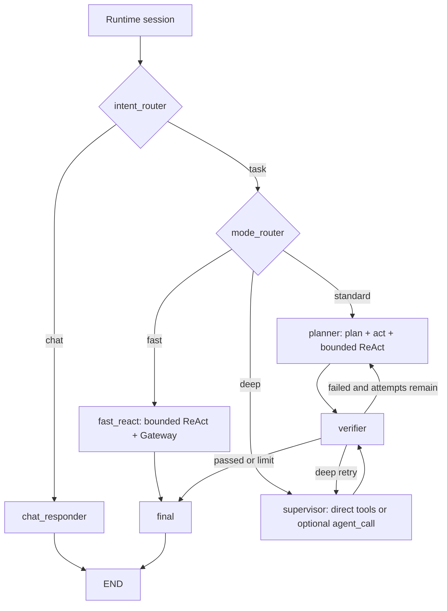
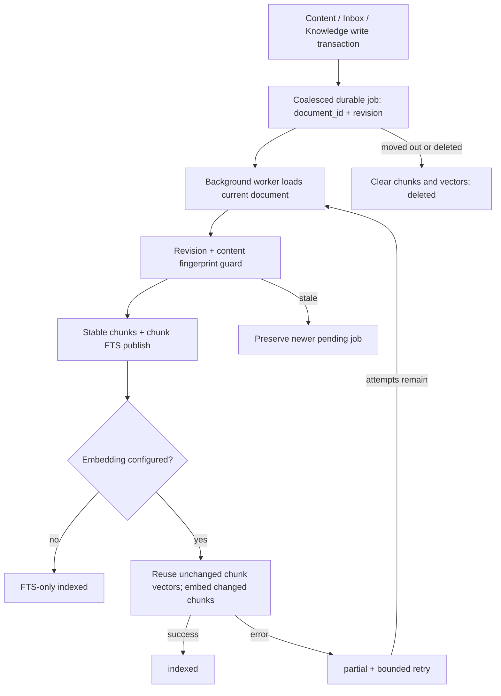
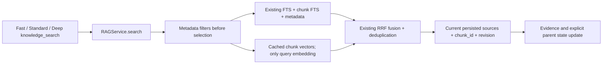
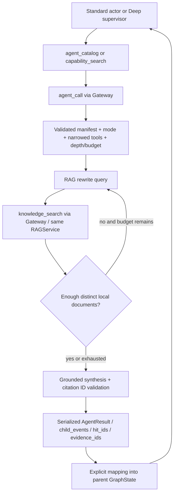

# Xiliu 0.2 内核与 RAG 重构交付

日期：2026-10-09。依据用户提供的三阶段实施方案，在当前工作区继续已有实现。Web 页面不重写，Knowledge 原件、document_id、标签、文件夹、会话与 NDJSON 协议继续复用。

## P0：模式路由与共享证据

实际主图如下。成熟 ReAct 的工具循环保留在每个执行节点内；工具经同一 ExecutionGateway，节点结束一次返回完整事件增量。没有人为增加三个互相广播的工具节点。



Fast 不暴露 Todo、SubAgent 或 Web 工具给本地查询，不运行 LLM Verifier；确定性区分工具失败、零命中和真实命中。Standard 保留计划验收；Deep 的 Todo 和委派均可选。显式 `Runtime.stream_session(..., mode="deep")` 或 `POST /api/conversations/{id}/chat` 的可选 `mode` 字段优先；旧请求不用改。CLI 原入口继续通过自动规则路由。

本地请求优先确定性标记为 task，避免模型误分到 chat。“不要联网”不会被视作联网授权；local_only 进一步在 Gateway 阻止 network.read 与 MCP，不能靠 Agent Prompt 绕过。

证据写入：真实工具结果 → ReAct event_id → Evidence → GraphState reducer → Memory / Verifier / Final。ToolMessage 不隐式变成状态字段。一个事件的多个文档证据用 `(event_id, source_id)` 幂等合并；事件和 AgentResult 分别按 event_id/call_id 合并，无 ID 的旧记录不按文本猜测合并。`retrieval_hits` 替换当前结果，旧 `research_notes` 作为兼容派生摘要保留。

P0 文件：`graph/{routing,state,workflow,nodes,memory,verification}.py`、`graph/modes/{fast,standard,deep}.py`、`execution/{gateway,evidence}.py`、`agents/react.py`、`capabilities/{models,manager,agent_registry,langchain_tools}.py`、`runtime.py`、`core/{agent,checkpoint}.py`。

## P1：独立后台索引和同一知识库



独立显式状态机由应用生命周期中的 IndexWorker 管理，不在聊天查询内执行索引。Content 写入时同一事务更新原 FTS 并入队、移除旧片段视图；索引在发布前和向量返回后再检查 revision 与标题/正文/摘要/来源/标签指纹。保留旧文档级 RetrievalService 作为兼容实现，新的工具和 HTTP API 均调用 RAGService。



SearchResult 同时保留旧 `items/mode_used/channels` 并提供 `ok/matched/hits/retrieval_mode/degraded`；Hit 包含真实 document_id、chunk_id、revision、title、snippet、tags、source_uri。本地 ID 可作来源，URL 可为空。查询不生成正文向量，不自动联网补零命中；可选向量失败返回 fts_only/degraded，索引状态为 partial。

P1 文件：`rag/{chunking,embeddings,ingestion,index_graph,service}.py`、`api/services/{content,retrieval}.py`、`api/app.py`、`tools/knowledge_search.py`。

迁移为既有 app.sqlite3 内的幂等增量表：`rag_migrations`、`rag_index_jobs`、`rag_chunks`、`rag_chunk_fts`、`rag_chunk_vectors`。首次迁移备份为同目录 `app.pre-rag.sqlite3`，不复制知识库或更换资料 ID。旧正文通过已有 content_fts 立即可查，后台为其补片段。迁移在临时旧数据样本上验证；没有操作用户实际 .xiliu 数据。回滚程序可停止服务后使用旧代码，新增表不影响旧读取；若恢复备份，需另保留备份后新增的内容与会话。

## P2：可配置 Agent 与本地多轮 RAG



内置 rag/research/code 模板位于 Python package 代码，不启动时写入用户目录；私有配置位于 Runtime 实际 data_dir 下 `agents/<id>/agent.yaml + prompt.md`。严格 schema、路径/链接检查、未知工具和递归委派拒绝；非法配置禁用并记录警告。`agent_catalog` 是独立只读目录入口，原 capability_search 权限保持不变。

RAG 只使用本地 Knowledge，rewrite/search/sufficiency/synthesize 具有独立局部状态；父 State 只接收简短结果和真实工具事件/证据。比较任务至少需要两个不同文档，显式篇数进入充分性判断。零命中继续有界改写，预算结束输出证据不足；模型引用 ID 不在真实命中中时不接受其综合，回退到实际片段及引用。

Research 仅在父任务明确请求外部来源且策略允许时可调用；网络白名单只缩小已有工具权限。Agent 工具范围、模式和深度限制不会替代 Policy/Hooks。旧 call_search_agent/call_code_agent 保留，新 code Agent 的结果和工具来源兼容现有验收。

P2 文件：`agents/{runtime,rag_agent,rag_state}.py`、`capabilities/agent_registry.py`、`tools/knowledge_search.py` 的 knowledge_get、必要 `graph/nodes.py`/Verifier 适配。

配置示例（用户自行放入实际 data_dir，不覆盖默认配置）：

```yaml
id: rag
name: Local Knowledge Research
kind: agent
description: 多轮本地知识检索和跨文档比较
allowed_modes: [standard, deep]
allowed_tools: [knowledge_search, knowledge_get]
network_access: false
max_iterations: 5
max_delegation_depth: 1
prompt_path: prompt.md
```

## 实际新增目录与兼容修改

```text
src/xiliu/
├── execution/evidence.py
├── graph/routing.py
├── graph/modes/{__init__,fast,standard,deep}.py
├── capabilities/agent_registry.py
├── agents/{runtime,rag_agent,rag_state}.py
└── rag/{__init__,chunking,embeddings,ingestion,index_graph,service}.py
scripts/verify_kernel_rag.py
tests/unit/{test_shared_evidence,test_graph_modes,test_agent_registry,
            test_rag_ingestion,test_rag_agent,test_kernel_security,test_kernel_boundaries}.py
```

其余兼容修改：`api/{schemas,app}.py`、`api/routes/conversations.py`、`api/services/chat.py`；Python、Web、Desktop 根包和 Tauri 的版本元数据统一为 0.2.0，Web 业务组件和样式没有为本次内核重写。

## 验证与实际证据

离线证明：`scripts/verify_kernel_rag.py` 使用真实 Runtime、Gateway、SQLite、索引和 Trace，以 fake model 控制决策，在临时目录创建三份资料。输出 `logs/development/xiliu-02-proof.json`：3 个后台作业、2 个 Memory 命中；Fast 节点为 mode_router → fast_react → final，Deep 为 mode_router → supervisor → verifier → final，内部有 rag 委派和父状态 Evidence。该文件同时保留实际 event_id/document_id/chunk_id、工具调用和图更新。

验证命令：

```powershell
.venv/Scripts/python.exe -m pytest -q -rs
.venv/Scripts/python.exe -m ruff check src/xiliu
.venv/Scripts/python.exe -m pyright src/xiliu
.venv/Scripts/xiliu.exe --help
.venv/Scripts/python.exe scripts/verify_kernel_rag.py
cd web
npm test -- --run
npm run lint
npm run build
```

记录：初始后端基线无失败；本地命中/research_notes 回归先观察失败再修复；模式、manifest、增量索引、片段向量缓存、RAG 循环、checkpoint、否定联网和同 revision 并发均有回归。前端 30 个测试通过，lint/build 通过；后端 Ruff 和 Pyright 已通过。最终后端统计见实施记录末尾，避免把历史测试数量当作本次结果。

最终验证：后端 **111 passed, 1 skipped**（14.21 秒）；唯一跳过为 Windows 缺少符号链接权限的既有 Intro 静态资源用例。Ruff 全部通过；Pyright 为 0 errors / 0 warnings。前端 **10 个文件、30 个测试通过**，eslint 与 TypeScript/Vite build 均退出成功。CLI `--help` 成功，`--version` 输出 `xiliu 0.2.0`。权限拒绝类不可恢复工具错误会直接退出，不再重复规划。

独立审查发现的否定联网、新 CodeAgent 验收来源、过滤顺序、启动失败线程清理均已处理并验证。

## 当前限制与交付边界

- 验证使用 fake model 和离线数据库，没有请求真实模型、Tavily 或外部 MCP；模型质量和真实联网 smoke 需要单独验证。
- 预算检查在模型/工具调用之间生效，不能强制中断正在阻塞的第三方同步调用；沿用现有 provider/tool 超时和取消传播。
- 单节点 ReAct 按批次写 State。已完成节点的 checkpoint 恢复不重复工具；批次中途崩溃尚无逐工具持久化的 exactly-once 保证，恢复时需依赖动作幂等和已有审计。
- 当前 Knowledge 为本机单用户存储，过滤遵循现有 status/标签/文件夹边界，没有新增多租户 ACL。Agent 的 network_access 约束工具目录和 Gateway，不是 OS 网络防火墙。
- 内核验收时验证了 Web 构建和后端接口 / CLI 兼容；后续已生成 0.2.0 中文 Tauri / NSIS 安装包并通过本机安装、启动与退出检查，详见 [Windows 交付记录](WINDOWS_RELEASE.md)。
- 工作区开始时已有大量 staged/unstaged 的 UI/Desktop/API 修改，因此保留用户 index，未将这些改动混入自动阶段提交。本次代码、测试和文档均在工作区，尚未生成三个独立 Git 提交。
- 自动审批曾拒绝降低全局 capability_search 权限；该补丁未应用，最终保留原权限并使用独立只读 agent_catalog。
