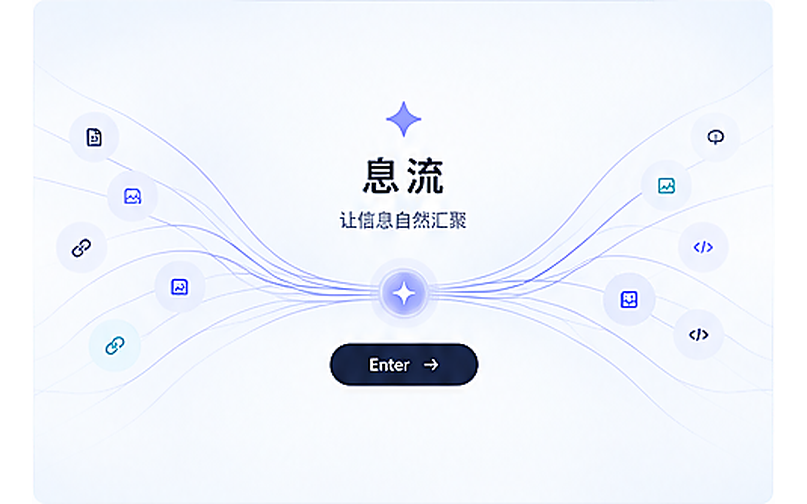
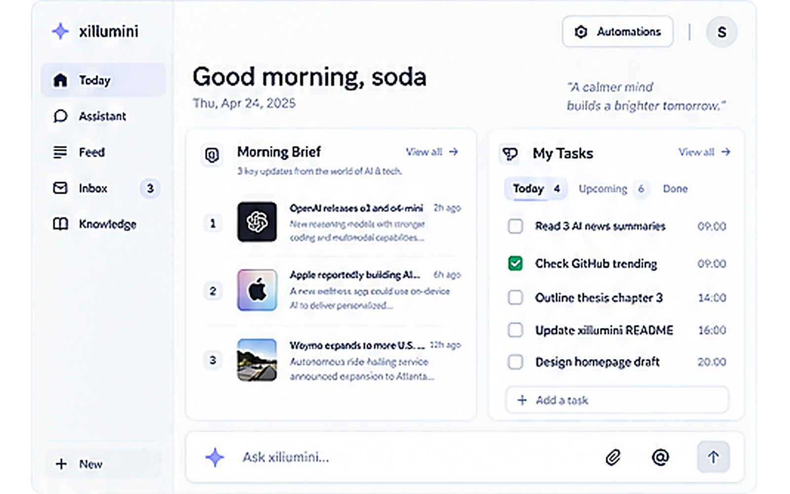
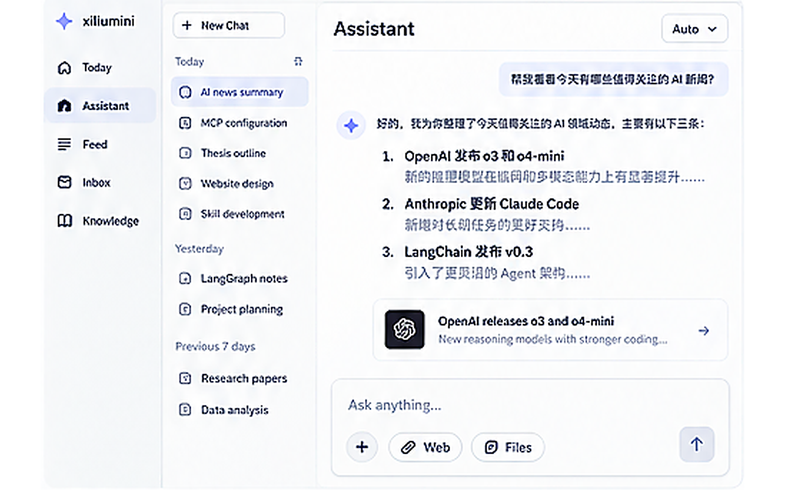
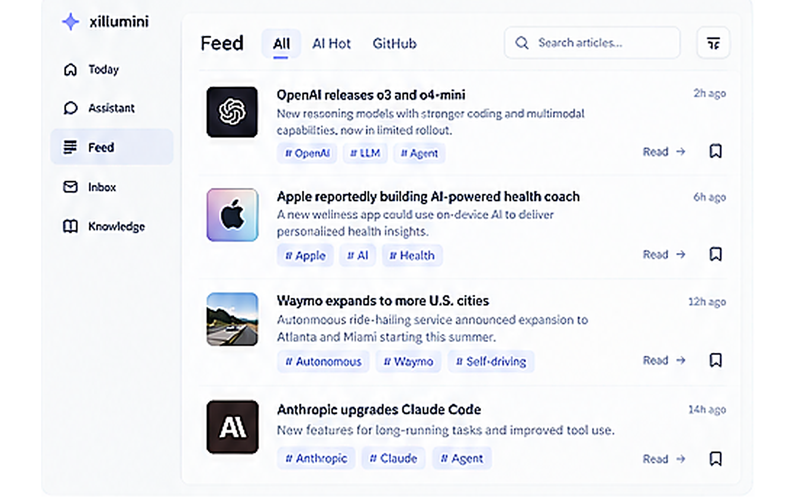
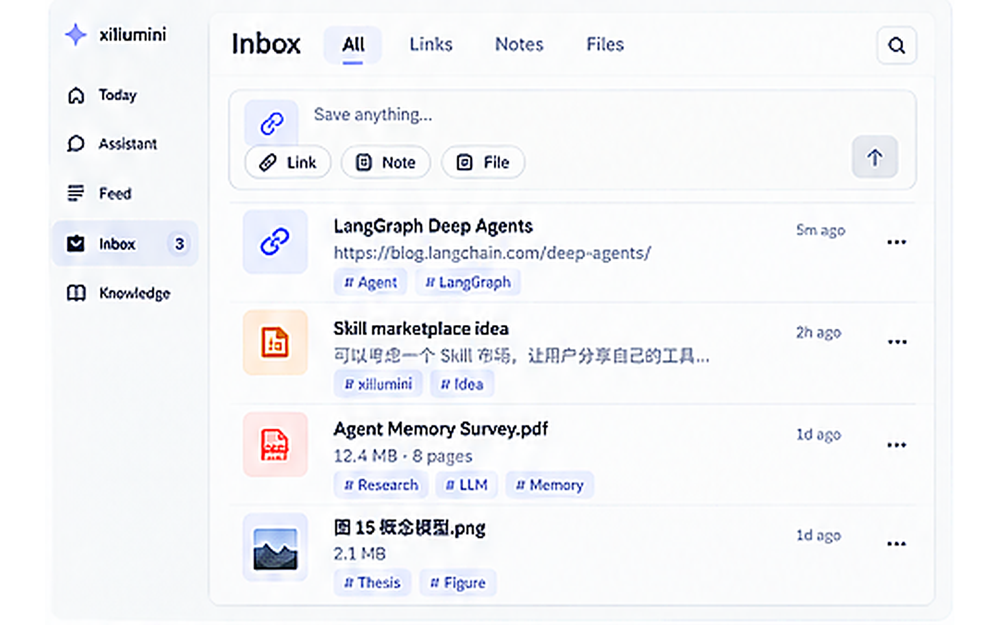
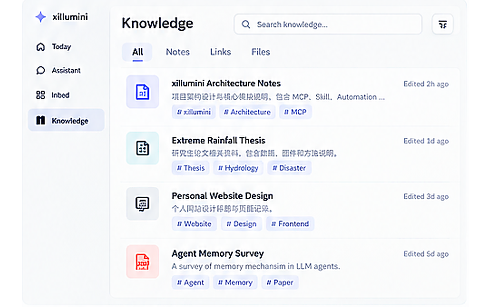
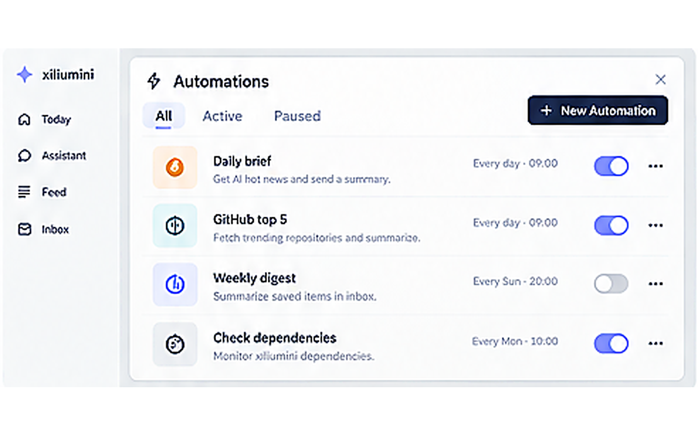
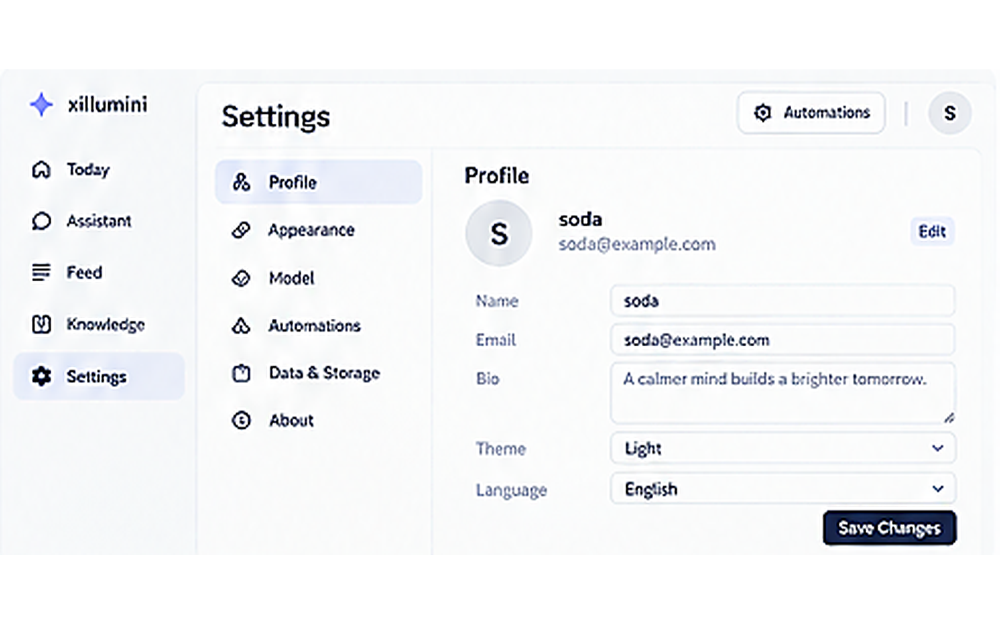

# 息流 UI v0.1 示意图

> 当前版本只用于确认页面结构、信息层级与交互方向。视觉基调沿用已确认的 xiliumini 风格：白色主背景、淡灰分隔、低饱和蓝紫强调色、轻阴影、圆角卡片、尽量克制的图标与装饰。

## 01 启动页



**用途：** 应用进入前的品牌页。以“百川归海 / 信息汇聚”为隐喻，中心保留 `Enter` 入口。第一版可用 SVG + CSS 完成，不引入 3D 或复杂粒子系统。

---

## 02 首页 Today



**用途：** 三块式首页。左侧为今日简报，中间/右侧为待办事项，底部保留“问问息流”的快速输入。Automation 与设置仍放在右上角作为次级入口。

---

## 03 Assistant 对话页



**用途：** 前端最先落地的核心页面。保留 xiliumini 内核，但不复用 TUI 交互界面；左侧增加可视化对话列表，可新建、切换历史对话。底部输入框后续加入 `/clear`、`/compress`、Skill 与 MCP 调用命令。

---

## 04 Feed 资讯页



**用途：** 聚合 AI Hot、GitHub Trending 等外部信息。统一成轻量列表卡片，后续支持搜索、筛选、收藏和“一键 Ask AI”。

---

## 05 Inbox 收集箱



**用途：** 临时信息入口。允许放入链接、文本、文件等内容，先保存、后整理。Inbox 不要求一开始就完成复杂分类，核心是“任何东西都能先收进来”。

---

## 06 Knowledge 知识库



**用途：** 存放已经整理过、准备长期保留的内容。第一版以搜索、分类、标签和列表为主，不做知识图谱或复杂关系网络。

---

## 07 Automations 自动化



**用途：** 次级功能页/抽屉。管理每日简报、GitHub Top 5、定时整理等自动任务，支持启停、查看状态和运行记录。

---

## 08 Settings 设置



**用途：** 管理用户资料、外观、模型偏好、连接、数据与存储等。第一版只保留真正需要配置的项目。

---

## 当前导航结构

- Today
- Assistant
- Feed
- Inbox
- Knowledge
- 右上角：Automations / Settings / Profile

首页是其他模块的汇总页，因此实现顺序建议从 **Assistant → Feed → Inbox → Knowledge → Automations/Settings → Today** 反向推进。

---

# 息流 Web v0.1 技术实施方案（供 Codex 直接执行）

> 本方案基于 `sodaa1/xiliumini` 的 `main` 分支制定，阅读时仓库 HEAD 为 `6d3689583f93b3fafd6381b2b65c31d9613464e5`。目标不是重写 xiliumini，而是在现有 Runtime / Capability Harness / Memory / Automation 之上增加一个薄 Web 层与独立 UI。
>
> **执行原则：** 先让 Assistant 真正可用，再做 Inbox / Knowledge / Feed，最后把这些数据汇总到 Today。遵循 TDD，但每个小步骤只跑与本步骤直接相关的少量测试；所有模块完成后再运行完整测试矩阵。

## 0. 先明确不做什么

v0.1 不把 Textual TUI 搬进浏览器，不把 Typer CLI 当成 Web 后端，不重写 LangGraph 工作流，不引入 Next.js Server、Redux、Electron、向量数据库、Alembic、WebSocket、复杂插件市场或知识图谱。

前端只负责界面和交互，后端通过 Python API 直接调用 xiliumini 的核心对象。CLI/TUI 保持可用，但 Web Assistant **不调用** `uv run xiliumini chat`，也不解析 TUI 输出。

开发时允许 Codex 使用 `uv run pytest`、`uv run ruff` 等命令；“不用 uv run”指的是最终用户使用 Assistant 时不需要通过 CLI/TUI 进行对话。

## 1. 已确认的现有 xiliumini 能力

Codex 开工前先再次读取这些文件，不要凭本方案猜接口：

- `src/xiliumini/runtime.py`
  - 已有 `Runtime.stream_session(...)`，可直接作为 Web 对话内核。
  - `create_runtime(settings, ...)` 会继续复用现有 Planner / Workflow / Checkpoint / Trace / Policy / Hook。
- `src/xiliumini/core/agent.py`
  - `stream_session_events(...)` 是当前 TUI 的适配层；Web 不直接复用这一层。
- `src/xiliumini/core/session.py`
  - 当前持久化面向单个 TUI session，最近只保留有限轮次；Web 多会话不要强行改造成 UI 数据库。
- `src/xiliumini/graph/memory.py`
  - `MemoryManager.prepare_planner_messages(...)` 已包含自动上下文压缩。
  - `_summarize_messages(...)` 是现有摘要核心，主动 `/compress` 应复用这一能力而不是再写一套摘要 prompt。
- `src/xiliumini/capabilities/langchain_tools.py`
  - 已有 `capability_search`、`skill_load`、`mcp_call`。
  - Skill / MCP 命令应继续通过现有 Capability / Execution Gateway / Policy / Hook 路径，而不是绕过安全层直接执行。
- `src/xiliumini/capabilities/skills.py`、`mcp.py`、`manager.py`
  - 已有 Skill 扫描、MCP provider/tool 发现和调用。
- `src/xiliumini/automation/store.py`
  - 已采用标准库 `sqlite3` + WAL，可直接借鉴其 Store 风格，不另加 ORM。
- `src/xiliumini/providers/openai_compatible.py`
  - 当前底层是 `ChatOpenAI`，已经支持 `model + api_key + base_url`，因此 OpenAI / DeepSeek 都不需要新建两套 Provider 类。

## 2. 总体架构

```text
浏览器
  │
  │ React + TypeScript
  ▼
web/  (Vite SPA)
  │
  │ HTTP + NDJSON Streaming
  ▼
src/xiliumini/api/
  │
  ├── services/ConversationService
  ├── services/ChatService
  ├── services/CommandService
  ├── services/ModelSettingsService
  └── 后续 Feed / Inbox / Knowledge / Tasks
          │
          ▼
      xiliumini Runtime
          │
          ├── LangGraph workflow
          ├── Memory / Checkpoint / Trace
          ├── CapabilityManager
          ├── ExecutionGateway / Policy / Hooks
          └── Automation
```

### 后端新增依赖

仅增加：

```toml
fastapi
uvicorn
```

不加 SQLAlchemy；继续使用 Python 标准库 `sqlite3`。

### 前端建议依赖

在仓库根目录增加 `web/`：

```text
React + TypeScript + Vite
Tailwind CSS
React Router
TanStack Query
Lucide React
react-markdown + remark-gfm
Vitest + Testing Library
```

第一版无需完整 shadcn 安装体系；需要的 Button / Input / Dialog / Dropdown 自己做少量本地组件即可，以便尽量贴合当前预览图。

## 3. 新增目录建议

```text
xiliumini/
├── src/xiliumini/
│   ├── api/
│   │   ├── __init__.py
│   │   ├── app.py
│   │   ├── schemas.py
│   │   ├── routes/
│   │   │   ├── conversations.py
│   │   │   ├── models.py
│   │   │   ├── capabilities.py
│   │   │   ├── inbox.py          # 第二阶段
│   │   │   ├── knowledge.py      # 第二阶段
│   │   │   ├── feed.py           # 第三阶段
│   │   │   └── tasks.py          # 第四阶段
│   │   └── services/
│   │       ├── conversations.py
│   │       ├── chat.py
│   │       ├── commands.py
│   │       ├── model_settings.py
│   │       ├── content.py
│   │       ├── feed.py
│   │       └── tasks.py
│   └── ...现有代码保持原结构
│
├── web/
│   ├── src/
│   │   ├── app/
│   │   ├── components/
│   │   ├── features/
│   │   │   ├── assistant/
│   │   │   ├── feed/
│   │   │   ├── inbox/
│   │   │   ├── knowledge/
│   │   │   ├── today/
│   │   │   └── settings/
│   │   ├── lib/api.ts
│   │   └── styles/
│   └── ...
│
├── tests/
│   ├── unit/
│   └── integration/
│
└── start-xiliu.bat               # v0.1 Windows 便捷启动，可最后再加
```

不要把前端源码塞进 `src/xiliumini/cli/tui/`。

## 4. Web 数据库：只建一个 `app.sqlite3`

位置：

```text
.xiliumini/app.sqlite3
```

沿用 `AutomationStore` 的风格：标准库 sqlite3、`journal_mode=WAL`、`busy_timeout=30000`、每次操作短连接。

v0.1 第一阶段只需要两个表：

```sql
CREATE TABLE conversations (
    id TEXT PRIMARY KEY,
    title TEXT NOT NULL,
    model_override TEXT,
    context_cutoff_seq INTEGER NOT NULL DEFAULT 0,
    compressed_through_seq INTEGER NOT NULL DEFAULT 0,
    context_summary TEXT NOT NULL DEFAULT '',
    created_at TEXT NOT NULL,
    updated_at TEXT NOT NULL
);

CREATE TABLE messages (
    id TEXT PRIMARY KEY,
    conversation_id TEXT NOT NULL,
    seq INTEGER NOT NULL,
    role TEXT NOT NULL,
    content TEXT NOT NULL,
    route TEXT,
    created_at TEXT NOT NULL,
    metadata_json TEXT NOT NULL DEFAULT '{}',
    UNIQUE(conversation_id, seq),
    FOREIGN KEY(conversation_id) REFERENCES conversations(id) ON DELETE CASCADE
);
```

约束：

- `role` 第一版只允许 `user / assistant / event`。
- `conversation.id` 直接使用 UUID，并同时作为 `Runtime.stream_session(..., session_id=...)` 的 session ID。
- 消息列表用于 UI 展示；xiliumini 的 LangGraph/Checkpoint 仍按原机制保存在 `.xiliumini/workspaces/<conversation-id>/...`。
- **不要把网页对话历史塞进现有 TUI `session.json`。** 两者是不同适配层，共用 Runtime 即可。

## 5. Assistant：第一优先级

### 5.1 UI 必须保持当前预览图风格

Assistant 页面固定三列逻辑：

```text
全局导航 | 对话列表 | 当前对话
```

左侧全局导航继续是 Today / Assistant / Feed / Inbox / Knowledge；中间是会话列表；右侧是当前消息和输入框。

对话列表需要：

- `+ New Chat`
- 今日 / 昨日 / 更早简单分组
- 点击切换会话
- 当前会话高亮
- 删除会话放在 `...` 菜单，不要默认展示一排操作按钮
- 第一条用户消息成功发送后，如果标题还是 `New Chat`，直接取首句前约 24 个字符作为标题；v0.1 不额外浪费一次模型调用生成标题

### 5.2 Assistant 顶部模型切换

右上角增加类似 Codex 的紧凑模型下拉框，例如：

```text
GPT-5.6 Terra  ▾
```

规则：

- Settings 中的 `model` 是全局默认模型。
- Assistant 下拉选择是**当前对话覆盖值**，保存到 `conversations.model_override`。
- v0.1 下拉只展示当前 Settings 里所选厂商的预置模型，避免同时管理两套 API Key。
- 当 Settings 更换厂商后，如果旧 conversation 的 `model_override` 不属于新厂商模型列表，下次打开自动回退到全局默认模型，并清空无效 override。

### 5.3 ChatService 不走 TUI

新增 `ChatService.stream_turn(conversation_id, text)`，流程：

```text
1. 读取 conversation
2. 追加 user message
3. 解析是否是 / 命令
4. 普通消息 -> build_context()
5. settings = load_settings()
6. 若 conversation.model_override 存在：settings.model_copy(update={"model": override})
7. runtime = create_runtime(settings, approval_mode="deny")
8. runtime.stream_session(
       task=text,
       session_id=conversation_id,
       context_summary=context,
   )
9. 将 RuntimeEvent 转成 WebEvent
10. FinalEvent 写入 assistant message
11. NDJSON 持续返回给前端
```

v0.1 Web 默认 `approval_mode="deny"`。先保证聊天、检索、只读 Skill/MCP 能稳定工作；需要危险命令审批时再单独做 Web Approval Card，**不要为了第一版聊天引入阻塞式审批通道**。

### 5.4 第一版流式协议：NDJSON，不做 token streaming

当前 Runtime 事件本身已经是稳定接口，但普通 chat 路由最终仍是整段 `FinalEvent`。第一版不要为了逐 token 输出改 LangGraph。

使用 FastAPI `StreamingResponse`，每行一个 JSON：

```json
{"type":"status","stage":"routing","message":"正在处理"}
{"type":"progress","stage":"planner","message":"..."}
{"type":"final","message_id":"...","text":"最终回答"}
{"type":"error","code":"provider_error","message":"..."}
```

前端用 `fetch()` + `ReadableStream` 按行解析。这样以后如果 Runtime 真正支持 token event，只需新增 `delta` 类型，不改整体架构。

### 5.5 Conversation API

第一阶段实现：

```text
GET    /api/conversations
POST   /api/conversations
GET    /api/conversations/{id}
PATCH  /api/conversations/{id}
DELETE /api/conversations/{id}
GET    /api/conversations/{id}/messages
POST   /api/conversations/{id}/chat      # NDJSON stream
GET    /api/commands
GET    /api/capabilities/skills
GET    /api/capabilities/mcp
```

`PATCH` 第一版只允许改标题和 `model_override`。

## 6. `/` 命令设计

输入框检测到第一个非空字符是 `/` 时显示命令面板；键盘上下选择，Enter 补全。**前端只负责提示；最终解析必须在后端 `CommandService`。**

### 6.1 `/clear`

用途：清除当前对话的“模型上下文”，不删除 UI 中已经显示的消息。

执行：

```text
latest_seq = 当前最后一条消息 seq
conversation.context_cutoff_seq = latest_seq
conversation.compressed_through_seq = latest_seq
conversation.context_summary = ""
追加 role=event："Context cleared"
```

之后 `build_context()` 只读取 `seq > context_cutoff_seq` 的消息。

UI 中历史仍然可滚动查看，中间显示一条轻量分隔：

```text
—— 已清除上下文 ——
```

### 6.2 `/compress`

目标：主动触发现有压缩/摘要能力，而不是新写一套压缩逻辑。

最小改法：

1. 在 `src/xiliumini/graph/memory.py` 将 `_summarize_messages(...)` 重构成可复用的公开 helper，例如 `summarize_messages(...)`；现有 `MemoryManager.prepare_planner_messages(...)` 改为调用它，行为保持不变。
2. `CommandService.compress()` 将当前 active context 的 user/assistant message 转成 LangChain `HumanMessage/AIMessage`。
3. 使用当前会话选择的模型调用同一个 `summarize_messages(...)`。
4. 保存：
   - `context_summary = summary`
   - `compressed_through_seq = 当前最后消息 seq`
5. 后续 `build_context()` 由“已有 summary + compressed_through_seq 之后的新消息”组成。
6. 加一条 `role=event`：`Context compressed`。

不要直接调用一个带私有下划线的函数；先做很小的公共 helper 重构，并用已有 memory tests 保证自动压缩逻辑无回归。

### 6.3 `/skill <name> [instruction]`

示例：

```text
/skill xiliumini-debugging 检查这次错误可能来自哪里
```

行为：

- `GET /api/capabilities/skills` 从现有 `SkillRegistry.scan()` 返回可用 skill 名称和 description。
- 后端先验证 `<name>` 存在。
- 不直接读取文件后绕过 policy；将用户请求转成显式 capability hint，例如：

```text
The user explicitly requested skill:xiliumini-debugging.
Load that skill with the existing skill_load capability before answering.
User request: ...
```

- 然后仍走 `Runtime.stream_session()`，由现有 `skill_load` + Execution Gateway 完成真正调用。
- 如果只输入 `/skill xiliumini-debugging`，返回该 Skill 的简短元信息和用法，不启动完整 workflow。

### 6.4 `/mcp <server> [instruction]`

示例：

```text
/mcp aihot 获取今天最重要的 AI 新闻
```

行为与 Skill 类似：

- `GET /api/capabilities/mcp` 返回 `MCPManager.servers()` 中的 server id。
- 验证 server 存在。
- 显式提示 Agent 使用 `capability_search(kind="mcp")` 在该 server 中发现能力，再通过现有 `mcp_call` 调用。
- 不在 Web 层自己拼 MCP HTTP/stdio 请求。
- 真正执行仍经过 xiliumini 现有 Gateway / Policy / Hook。

v0.1 暂不设计 `/mcp server/tool {json}` 这种复杂语法；先以“server 名 + 自然语言指令”为主。

## 7. 模型设置与模型切换

### 7.1 Settings 页面字段

模型设置卡片包含：

```text
厂商 Provider
模型 Model
API Key
API 地址 Base URL
```

厂商第一版只有：

```text
OpenAI
DeepSeek
```

选择厂商时自动填充默认 Base URL，并更新模型列表。

### 7.2 v0.1 预设模型

为了让 preset 与实现解耦，集中放在一个常量文件，例如：

```text
src/xiliumini/api/model_catalog.py
```

建议初始值：

```python
MODEL_CATALOG = {
    "openai": {
        "base_url": "https://api.openai.com/v1",
        "models": [
            "gpt-5.6-sol",
            "gpt-5.6-terra",
            "gpt-5.6-luna",
        ],
    },
    "deepseek": {
        "base_url": "https://api.deepseek.com",
        "models": [
            "deepseek-v4-flash",
            "deepseek-v4-pro",
        ],
    },
}
```

这些只是 UI preset，不应写进数据库 schema；以后增加“自定义 Provider/Model”只需扩展 catalog 与设置页，不迁移 conversation 表。

### 7.3 配置仍复用现有 `.env`

为了避免新增一套密钥系统，v0.1 继续以现有 `.env` / `Settings` 为 source of truth。

在 `Settings` 新增：

```python
provider: Literal["openai", "deepseek"] = "openai"
```

并在 `.env.example` 增加：

```text
XILIUMINI_PROVIDER=openai
```

Settings API：

```text
GET /api/models/catalog
GET /api/settings/model
PUT /api/settings/model
```

`PUT` 使用项目已经依赖的 `python-dotenv` 的 `set_key()` 原子/安全地更新：

```text
XILIUMINI_PROVIDER
XILIUMINI_MODEL
XILIUMINI_API_KEY
XILIUMINI_BASE_URL
```

安全规则：

- GET **永远不返回 API Key 明文**，只返回 `api_key_set: true/false`。
- PUT 中 `api_key` 缺省或空字符串代表“保留现有 key”；不要因为用户只切模型就清空密钥。
- Base URL 校验只接受 `http://` 或 `https://`。
- 修改成功后不维持长期 Runtime 单例；下一次 turn 重新 `load_settings()`，因此设置立即生效，也符合当前 xiliumini 每轮创建 Runtime 的做法。

### 7.4 Provider 实现不要拆成两个类

OpenAI 与 DeepSeek 都继续使用当前 `create_chat_model(settings)` / `ChatOpenAI`。

仅通过：

```text
api_key
model
base_url
```

区分。不要新增 `DeepSeekProvider`，除非未来 DeepSeek 接口不再 OpenAI-compatible。

## 8. Inbox 与 Knowledge：Markdown 是统一语义层，但原文件保留

第二阶段再做，不要阻塞 Assistant。

### 8.1 文件组织

```text
.xiliumini/content/
└── <item-id>/
    ├── item.md
    └── original.pdf / original.png / original.xxx   # 有原附件时
```

`item.md`：

```markdown
---
id: ...
type: link | note | file
status: inbox | knowledge
source: ...
created_at: ...
tags: []
---

# 标题

## Content
...

## Summary
...
```

原则：

- 纯文本/笔记：内容直接进入 Markdown。
- URL：Markdown 保存 URL、用户备注、后续抓取/摘要结果。
- PDF / 图片 / 其他文件：原文件不转换丢弃，`item.md` 只是统一的可检索说明层。
- Inbox → Knowledge **不复制文件**，只更新 `status`。

### 8.2 数据库扩展

在同一个 `app.sqlite3` 中后续增加：

```text
content_items
content_fts (FTS5)
```

SQLite 保存索引与状态，Markdown 文件保存真正可迁移的内容。

第一版搜索用 FTS5；不要引入 Chroma/Qdrant/Milvus/embedding。确实需要语义搜索时再加。

### 8.3 第一版支持范围

Inbox 第一版：

- 输入 Note
- 粘贴 URL
- 上传文件并保存原件
- 手动改标题/标签
- `Save to Knowledge`
- `Ask AI`：把 item 内容作为一次 Assistant 附加 context

PDF OCR、网页全文抽取、图片识别都属于后续增强，不要为了“什么都能收”而第一版全部实现。

## 9. Feed

第三阶段实现。

统一后端结构：

```text
FeedItem
- id
- source
- title
- summary
- url
- published_at
- tags
- metadata
```

来源第一版只有：

```text
AI Hot
GitHub Top 5
```

要求：

- AI Hot 复用现有 MCP `aihot`，不要在前端直接访问 provider。
- GitHub Top 5 可以先由现有 Automation 生成/缓存；Feed 只读取标准化结果。
- UI 只需要 `Read / Save / Ask AI`。
- `Save` 写入 Inbox。
- `Ask AI` 新建或跳转 Assistant，并把 FeedItem 作为临时 context。

## 10. Tasks 与 Today

第四阶段实现一个极简任务表：

```sql
CREATE TABLE tasks (
    id TEXT PRIMARY KEY,
    title TEXT NOT NULL,
    completed INTEGER NOT NULL DEFAULT 0,
    due_at TEXT,
    created_at TEXT NOT NULL,
    updated_at TEXT NOT NULL
);
```

只做：

- 新建
- 勾选完成/恢复
- 删除
- 查看全部

Today 最后做，因为它只是已有模块的聚合：

```text
Today
├── Morning Brief    <- Feed
├── My Tasks         <- Tasks
└── Ask xiliumini    <- Assistant 快速入口
```

Today 不存自己的业务数据。

## 11. Automation

继续保持次级入口，不放主导航一级。

右上角点击后打开 Drawer。第一版直接读取现有 `AutomationStore`：

- list
- enable / disable
- recent runs
- create 简单任务

不要复制一套自动化数据库。

## 12. Settings 其他部分

第一版只实现：

- Model：Provider / Model / API Key / Base URL
- Appearance：Light 固定或简单 Light/System
- Data：显示 data dir 路径与数据库状态

Profile、语言、复杂账户体系可以先用静态 UI 占位或暂不展示，不要做登录系统。

## 13. 启动方式

开发模式：前后端可分开运行。

最终 v0.1：FastAPI 托管 `web/dist/` 静态文件，浏览器打开本地地址，例如：

```text
http://127.0.0.1:8765
```

增加一个轻量 launcher：

- `xiliumini web --open`：面向开发/高级用户。
- `start-xiliu.bat`：Windows 双击启动，内部调用当前 venv 中的 xiliumini web，并自动打开浏览器。

用户进入 Assistant 后只使用 Web UI，不需要再运行 `uv run xiliumini chat`，也不会看到 Textual TUI。

## 14. TDD 执行顺序

> 每一个 Phase 都遵循“先写一个最小失败测试 → 实现 → 跑该模块测试”。不要每完成一个小函数就跑全套。Phase 7 最后再做完整回归。

### Phase 0 — 基线确认

Codex：

1. 拉取最新 `main`，记录 commit SHA。
2. 阅读本方案第 1 节列出的现有文件。
3. 运行一次当前全量测试，确认改动前基线是绿的；若基线本身失败，先记录，不要顺手大修无关问题。
4. 不修改 TUI UI。

完成标准：知道当前失败/通过基线，确认 `Runtime.stream_session()` 可以成为 Web 内核。

### Phase 1 — 后端 Web Skeleton + Model Settings

**先写测试：**

- `tests/unit/test_model_settings.py`
  - provider preset 正确
  - DeepSeek/OpenAI model 校验
  - GET 不泄露 API key
  - 空 api_key 更新时保留旧 key
- `tests/integration/test_api_health.py`
  - FastAPI app 可启动，`/api/health` 返回 200

**再实现：**

- `pyproject.toml` 增加 FastAPI/Uvicorn
- `Settings.provider`
- `api/app.py`
- `api/model_catalog.py`
- `ModelSettingsService`
- model routes

**本阶段只跑：** 新增 model settings + API health 测试、相关 config 测试、Ruff 针对改动文件。

### Phase 2 — ConversationStore + ChatService

**先写测试：**

- `tests/unit/test_conversation_store.py`
  - 创建/列出/重命名/删除
  - message seq 单调递增
  - model_override 保存
  - clear cutoff 后 build_context 不包含旧消息
- `tests/unit/test_chat_service.py`
  - 使用 fake Runtime，确认调用 `Runtime.stream_session(task, conversation_id, context)`
  - FinalEvent 被持久化
  - ErrorEvent 不写成 assistant 成功消息

**再实现：**

- `AppStore`
- `ConversationService`
- `ChatService`
- conversations routes
- NDJSON adapter

**关键约束：** Web service 直接调用 Runtime，不 import `cli.tui`，不执行 shell 命令启动 xiliumini。

### Phase 3 — Assistant 前端

**先写少量组件测试：**

- 新建会话后出现在列表
- 切换会话会重新加载 messages
- 模型 dropdown PATCH 当前 conversation
- 输入 `/` 会出现命令菜单

**再实现：**

- Vite React TS skeleton
- 统一 layout / sidebar
- Assistant 三列布局
- conversation list
- message renderer
- NDJSON chat reader
- model selector
- slash command palette

视觉以本 Markdown 中 `03-assistant.png` 为基准，不要自己换成深色终端风。

### Phase 4 — Slash Commands

**先写测试：**

- `/clear`：可见消息仍存在，但后续 context 不含旧消息
- `/compress`：调用共享 summarize helper，保存 summary/through_seq
- `/skill missing`、`/mcp missing` 返回稳定错误
- `/skill valid`、`/mcp valid` 生成正确 capability hint，不绕过 Runtime

**再实现：** `CommandService` 与前端补全列表。

同时给 `graph/memory.py` 增加共享摘要 helper，并确保原有自动压缩测试仍通过。

### Phase 5 — Inbox + Knowledge

**先写测试：**

- note/url/file 三种 item 创建
- original file 保留
- `item.md` 可读
- inbox → knowledge 只改 status
- FTS 查询能找到 Markdown 文本

**再实现 UI 与 API。**

不要做 embedding。

### Phase 6 — Feed + Tasks + Automation Drawer + Today

按模块各写 2～4 个关键测试即可：

- Feed normalize + Save to Inbox
- Task CRUD
- Automation list/toggle 调现有 Store
- Today 聚合接口/前端只消费已有服务

最后再完成启动页动画；动画只用 SVG/CSS，失败时应降级为静态品牌页，不影响主应用。

### Phase 7 — 完整回归与交付

最后一次统一跑：

```text
Backend
- 全量 pytest
- Ruff check
- Ruff format --check
- Pyright

Frontend
- npm test -- --run
- npm run lint
- npm run build

Smoke
- 启动 Web server
- GET /api/health
- 新建 conversation
- 切换 model
- 发一轮真实对话（若本机已有有效 API key）
- /clear
- /compress
- /skill <existing-skill>
- /mcp aihot <request>（若 aihot 可连接）
- Inbox 保存一条 note，并移动到 Knowledge
```

真实 provider / MCP 测试只作为最后 smoke，单元测试一律 mock，避免测试依赖网络和付费 API。

## 15. API 返回错误规范

后端统一：

```json
{
  "error": {
    "code": "model_not_configured",
    "message": "请先在 Settings 配置模型接口。"
  }
}
```

建议稳定 code：

```text
conversation_not_found
invalid_command
skill_not_found
mcp_not_found
model_not_configured
provider_authentication_failed
provider_rate_limited
provider_timeout
provider_error
```

已有 `classify_provider_error()` 的错误映射继续复用，不在 API 层解析供应商原始异常字符串。

## 16. 前端样式约束

保持已确认的 UI：

- 白色/近白背景
- 左侧固定浅色导航
- `#0f172a` 一类深蓝黑正文
- 蓝紫仅用于 active / focus / primary action
- 轻边框、轻阴影、10–16px 圆角
- 不做大面积渐变背景
- 不把 MCP / Skill / Hook / Policy 等工程概念放进主 UI
- Assistant 的运行过程最多显示一行轻量状态，如“正在调用 AI Hot…”，技术 trace 默认隐藏
- 页面宽度适配 1366–1920 桌面优先；移动端 v0.1 只要求不崩，不做完整移动端产品设计

## 17. Codex 每个 Phase 的提交要求

每完成一个 Phase：

1. 只提交与该 Phase 有关的文件，不顺手重构无关模块。
2. 在回复中列出：改动文件、完成内容、定向测试结果、仍未实现的下一阶段内容。
3. 如果发现本方案与最新仓库冲突，以最新仓库已有公共接口为准，优先做“小适配”，不要大规模重写核心。
4. 如果需要修改现有核心 API，先增加兼容参数或 helper，保持 CLI/TUI 现有行为和已有测试。
5. 不把 API key、`.env`、SQLite 运行数据、上传文件提交进 Git。

## 18. v0.1 完成定义（Definition of Done）

满足以下条件才算前端 v0.1 核心完成：

- 浏览器能打开息流 UI，不进入 Textual TUI。
- Assistant 可新建、切换、删除多个可视化会话。
- 对话真正调用 xiliumini `Runtime`，而不是 mock 或另起一套 Agent。
- Settings 可配置 OpenAI / DeepSeek 的 Provider、Model、API Key、Base URL。
- Assistant 可按会话切换当前 provider 下的模型。
- `/clear`、`/compress`、`/skill`、`/mcp` 可用。
- Inbox 能保存 note / URL / file，Knowledge 能接收整理后的 item，并可用 FTS 搜索。
- Feed 能显示 AI Hot + GitHub Top 5，并能 Save / Ask AI。
- Today 展示 Feed 摘要 + Tasks + Ask xiliumini。
- Automations 仍使用现有 AutomationStore，没有第二套调度系统。
- CLI/TUI 旧功能没有因 Web 层而被破坏。
- Backend + Frontend 完整测试通过，生产构建成功。

## 19. 预留但本轮不要实现

```text
自定义 Provider / 自定义 Model
多 Provider 同时保存多份 API Key
真正 token-by-token streaming
Web 工具审批卡片
向量/语义检索
跨设备账号同步
Electron / Tauri 桌面壳
移动端 App
知识图谱
Skill Marketplace
```

这些能力都可以在现有边界上逐步增加，不需要推翻 v0.1。

## 20. 模型 preset 维护说明

模型 preset 是易变配置。实现时把它集中到 `model_catalog.py`，不要散落在 React 组件或数据库 migration 中。

本方案撰写时核对的官方文档显示：OpenAI 当前仍提供 GPT-5.6 Sol / Terra / Luna API 模型；DeepSeek V4 API 使用 `deepseek-v4-pro` 与 `deepseek-v4-flash`，旧 `deepseek-chat` / `deepseek-reasoner` 已在 2026-07-24 后退出。因此第一版使用上述 ID，后续升级只改 catalog 常量即可。

