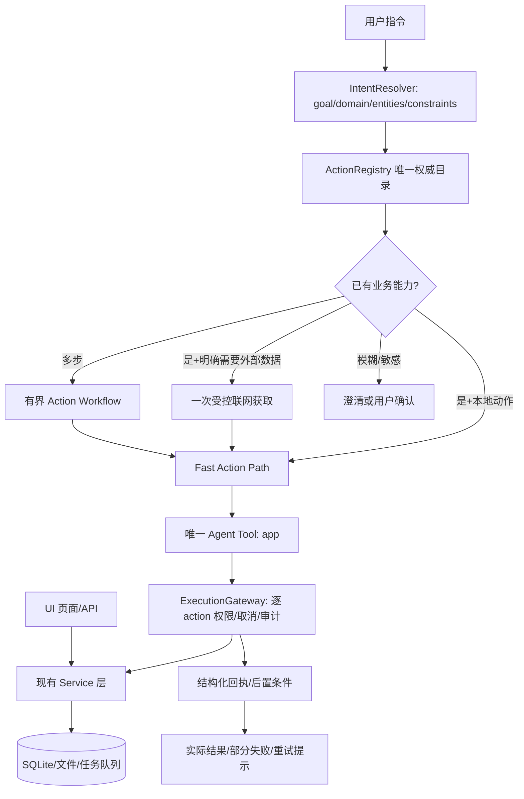

# Xiliu v0.4：全应用统一操作入口、Fast 优先路由与代码瘦身 — Codex 直接执行规格

> **目标仓库**：https://github.com/sodaa1/xiliu
> **审查基线**：公开 `main@d6df16e796dd0aca3a73c2cb3ed65369956ef638`（2026-10-09）。开始执行前以用户本地最新提交及未提交更改为准，不要覆盖后来已经完成的修复。
> **本次范围**：全页面能力盘点/测试；一个 Agent 可见的 App 操作入口；本地 Fast、联网增量一步；删除旧的 App 工具适配与冗余；分析并缩小发布包。**不要重新设计 UI，不要重写 RAG/LLM/SQLite 核心，不要创建第二套业务服务。**
>
> **必须交付真实代码**，不是再写一篇规划。保留业务数据与既有手动 UI 操作；提交测试、矩阵、前后性能/体积报告及构建结果。

## 0. 现状与为什么反复失败（以真实代码为依据）

| 现有位置 | 已确认事实 | 本次调整方向 |
|---|---|---|
| `src/xiliu/graph/routing.py` | `app_action` 用少量正则识别应用写入，“分类归入”等可能漏判；“知识库”命中本地检索 | 用结构化意图与能力匹配替代关键词增长；所有 App 修改不再无声落入只读检索 |
| `src/xiliu/graph/modes/fast.py` | 本地任务只构造 `build_knowledge_tools()`，通常只见 `knowledge_search`/`knowledge_get` | Fast 同样使用统一 `app`，支持有权限的本地读写 |
| `src/xiliu/graph/nodes.py`、`src/xiliu/agents/runtime.py` | Planner、Fast、子 Agent 分别拼装自己的工具列表和白名单 | 所有 App 能力由一个 Registry 统一发布；执行模式不改变业务能力清单 |
| `src/xiliu/tools/app_tools.py` | 存在 `inbox_import/inbox_list/knowledge_folders/inbox_classify` 等独立 Agent 工具 | **迁移并最终删除这些 Agent Tool 实现**，统一为一个 `app`；保留原 InboxService 等业务逻辑 |
| `src/xiliu/tools/knowledge_search.py` | Agent 另以 `knowledge_search`、`knowledge_get` 独立工具访问 RAG | 搜索/读取能力也纳入 `app` action 命名空间；RAGService 保持不变，旧 Agent 工具经测试后移除 |
| `src/xiliu/capabilities/manager.py` | `BUILTIN_PERMISSIONS` 逐个写死工具名 | `app` 调度时必须按具体 action_id 动态判权限，不得给所有动作统一宽松权限 |
| `src/xiliu/api/services/inbox.py` | 已有导入、异步元信息、批量归类等业务能力 | 扩展为单步/批量 Action Handler；解决异步状态与重复执行 |
| `src/xiliu/api/services/knowledge.py`、`.../content.py` | 已有文件夹 CRUD、内容 CRUD、归档路径 | 复用现有 Service，指定文件夹必须按真实 folder_id 落库 |
| `src/xiliu/api/services/feed.py` | 资讯来自 AIHot/GitHub 缓存；当前 `list/refresh/save`，**没有用户添加资讯及删除/隐藏的完整服务** | 最小新增持久的手动资讯与隐藏记录，统一接入 UI/HTTP/Agent；不能把自定义条目塞进刷新会覆盖的 cache |
| `src/xiliu/api/services/tasks.py` | 首页 Todo `list/create/update/delete` 已完整 | 直接复用，不能再造 Todo 数据层 |
| `src/xiliu/api/services/automations.py` | 已有 `list/create/toggle/delete/runs` | 统一注册；调度/删除做权限与执行回执验证 |
| `web/src/features/settings/*` | 外观和个人偏好在前端/桌面偏好存储；模型密钥由后端维护 | 非敏感偏好需有安全同步适配；密钥读写限制为 `restricted`，不得泄露或由 Agent 任意修改 |
| `.gitignore` | 忽略 `/tests/`、`*.test.*` 等 | **正式测试必须入 Git**；不能再把“本地测试通过”当成仓库可复现依据 |
| `desktop/build_sidecar.py` | PyInstaller `--collect-submodules` 范围广，可能把无用模块与资源打进包 | 构建前后逐项测量并裁剪；保留动态导入所需模块 |

**此次完整问题复现**（必须使用原句，不能只测试“归类”关键词）：

- “将Inbox里面内容分类归入知识库” → 应枚举当下 Inbox 快照、批量归档、验证每个 ID。
- “把我收件箱里还没整理的内容都搬到知识库” → 同上。
- “在知识库创建一个叫面试的文件夹，把 https://github.com/CHENG-LIANG1/real-company-interview-ai-coding-projects 先放 Inbox 生成标签再归档，只保存链接不要克隆” → 应使用服务，并验证 URL/文件夹关联。
- “给 Feed 加入 https://example.com/story 作为资讯” → 应新增**手动资讯记录**并在页面显示，不能导入 Inbox 冒充完成。
- “删除 Feed 里我刚添加的资讯” / “隐藏今天这条 AIHot 资讯” → 两种删除语义不同，但都可经同一入口处理。
- “帮我创建一个明天下午的待办”“标记已经做完”“删除它” → 必须操作 Today 真正的 `tasks` 表。
- “Inbox 有什么？”、 “知识库里有面试相关资料吗？”、 “怎么将 Inbox 分类？”、 “不要操作，解释一下” → 不得产生写入。

---

## 1. 统一架构：对 Agent **只有一个 App 入口**

**不可接受**：为了覆盖 Feed 再新增 `feed_add_tool`/`feed_delete_tool`、为了 Today 再新增 4 个 Agent 工具，或让每个模式拥有自己的工具清单。**推荐唯一公开工具名：`app`。** 允许内部 Service 方法、Action Handlers 是多个，但模型可见 App Tool 只能一个；通用 WebSearch/MCP/代码执行（非 Xiliu App 业务功能）保持为各自专业能力，不受“一个 App 入口”限制。



### 1.1 单个 `app` 工具协议（内部模型可调整，**不要暴露 N 个工具**）

建议 Pydantic 参数模型：

```python
class AppToolRequest(BaseModel):
    operation: Literal["catalog", "describe", "execute"]
    action_id: str | None = None          # 如 inbox.classify_all / feed.add_manual
    arguments: dict[str, Any] = Field(default_factory=dict)
    request_id: str | None = None         # 重复调用去重/审计用
    confirmation_id: str | None = None   # 高风险操作专用、不可由模型自造
```

- `catalog`：按 domain/查询返回紧凑目录（id、描述、`local|network|restricted`、必要参数名）；总量限制，**不**把整个 App 源码或大 JSON 灌给模型。
- `describe`：只展开所选 action 的参数、前置条件、危险性和示例，避免每轮重复发送几十个 schemas。
- `execute`：按 action_id 动态校验参数后，调用对应原有 Service；返回统一 `ActionResult`，禁止工具返回“已完成”却没有真实写入。
- 专属的 `fast_business_path` 对高置信常见命令可直接依据同一 Registry/Executor 执行，不要求一定先让模型调用 `catalog`；**Agent 可见的 App Tool 仍只有 `app` 一个**，执行入口唯一。
- 所有 Handler 的业务逻辑只引用现有 Service 或极薄的组合服务。**禁止另建一套 Inbox/Feed/Task 数据库、绕开 Service 直接 SQL 修改、Agent 模拟 DOM 点击、模型任意构造 `localhost` HTTP 请求。**

统一返回（建议）：

```json
{
  "ok": true,
  "action_id": "inbox.classify_all",
  "status": "completed",
  "records": [{"id":"persisted-item-id", "status":"knowledge"}],
  "counts": {"total":1,"succeeded":1,"failed":0,"skipped":0},
  "verification": {"passed":true,"checked":"persisted_state"},
  "next": null
}
```

`status` 区分 `completed|partial|pending|failed|confirmation_required|cancelled`；不能把异步任务已提交说成处理完成。`records` 是可溯源的真实对象 ID；不要在 trace 里记录密钥/长正文。失败错误码包括 `capability_unavailable`、`policy_denied`、`invalid_arguments`、`requires_network`、`confirmation_required`、`conflict`、`service_error`、`verification_failed`。

### 1.2 唯一 Registry 和 ServiceContext

建议将新增文件收敛为少量：

```text
src/xiliu/app/
  actions.py       # 所有 ActionSpec + schema + 服务绑定（可按域拆分注册数据，非 N 个工具）
  dispatch.py      # AppDispatcher：catalog/describe/execute + Gateway/Policy
  intent.py        # Typed intent + route + safety gates
  workflows.py     # 多步骤确定性组合；内部复用 dispatcher
  contracts.py     # 统一 ActionSpec/Result/Context 类型（代码少时可合并到 actions.py）
src/xiliu/tools/app.py  # **唯一**公开 BaseTool/StructuredTool 适配器
```

正式改动时以实际模块最少为原则：**总新增模块数不是 KPI，尽量合并，减少文件与桥接层。** 无必要不要新增另一个 Graph、Agent、MCP server、搜索服务或第二套路由器。

Registry 应单一来源声明（或 Code-gen 产生导出）：`id`、`domain`、`args_schema`、`handler`、`side_effect`、`permission`、`requires_network`、`confirmation_policy`、`idempotency`、`postcondition`、`ui_binding`/`service_binding`、`agent_availability`（enabled/restricted/ui_only）。`AppServices` 从 FastAPI 已有 `app.state` 注入 Runtime；CLI/TUI/后台有一致、明确的 ServiceContext 初始化，缺服务必须返回 `service_unavailable`，不能默默省掉工具。

**动态权限必须正确**：在 `ExecutionGateway._policy_target()`（或更小的 action-aware 网关）对 `app.execute` 解析 action_id 并查询 Registry，再用 action 的 `knowledge.read` / `knowledge.write` / `tasks.write` / `feed.write` / `network.read` 等经过 PolicyEngine 判断。未知 action **默认拒绝**。不能把 `app` 整体登记成 `knowledge.write=allow` 以绕过真实权限；多个 effect 的工作流逐项鉴权。敏感设置禁止工具返回原始密钥；不允许模型自发生成确认 token。

---

## 2. 路由：本地 Fast 优先，联网最多额外一步

**将“用户目标”和“执行模式”解耦。** 过去“本地范围 = Fast 只读知识库”的假设必须取消；本地 Fast 可以对已有对象读写，取决于动作权限，不取决于本地/知识库关键词。

### 2.1 结构化意图（建议字段）

```json
{
  "kind": "app_action",
  "domain": "inbox",
  "goal": "classify_all",
  "objects": {"scope":"current_inbox"},
  "constraints": {"target":"knowledge", "clone":false},
  "network_need": "none",
  "effect": "write",
  "confidence": 0.98
}
```

可选 `kind`: `conversation|knowledge_question|app_action|complex_project|external_research`。`network_need`: `none|optional_metadata|required_remote_data`，**不能把模型走云 API 推理与“进行网页搜索/爬取”混为一谈**。关键词只用于强约束/禁止误写（“怎么做”“不要操作”“只解释”）及高置信模板路由；开放同义句由轻量模型在歧义时做语义解析，校验输出结构，禁止无限追加中文正则。

### 2.2 路由性能合同

| 请求类型 | 路由 | 最大模型调用（典型） | 外部访问 | 执行 |
|---|---|---|---|---|
| “列出 Inbox”/“完成待办 X”/“分类归档所有 Inbox” | Fast App | 0–1 次轻量意图调用；不进 Planner/Verifier | 无网页抓取；本地规则默认无外部抓取 | 一次 `app.execute` 或后台批处理 |
| “给 Feed 加入这个 URL，只存链接” | Fast App | 0–1 次 | **不请求 URL** | `feed.add_manual` 本地入库 |
| “将这个 URL 加到 Feed，并抓取标题” | Fast + fetch | 0–1 次 | 只调用对应 FeedService 的受控 fetch **一次**（可超时降级） | 保留用户原 URL，写本地 manual 条目 |
| “刷新 Feed” | Fast + fetch | 通常 0 次 | 交由 FeedService 原有 AIHot/GitHub 接口；不调通用 SearchAgent | 返回真实刷新源状态 |
| “比较五篇本地文章” | Fast RAG 或较长本地流程 | 按 RAG 预算 | 不自动联网 | 读知识库，不产生写入 |
| 深度多代理调查/编程 | Standard/Deep | 依原策略 | 根据明确请求 | 原工作流保留 |

- 对有明确对象 ID、明确操作的请求尽量**零 LLM 直接路由**；含歧义但可处理的自然语言可进行一次小模型解析，**不要**为了既有按钮级功能调用 SearchAgent/CodeAgent、三轮 Planner 或冗长 Verifier。
- 多步业务操作（“导入 URL → 建文件夹 → 归档”）是确定性有限步骤的 App Workflow，不等于 Deep 多代理推理。一个请求可经内部多个 Service 调用，不要求模型逐步规划。
- 分类无需额外联网时优先本地标签规则、后台索引/批处理；若用户明确选择 AI 标签生成，则后台异步处理，返回 `pending` 与进度，不阻塞对话直到几十条完成。保留 UI 的已有 AI 整理设置与优先级，不能偷偷改变数据质量承诺。
- 性能目标：先测基线再设同机回归阈值；建议 **单项暖启动本地 App 读取/写入 p95 ≤2 秒，明显可识别意图不发生通用 WebSearch；批量操作在合理时间返回 accepted/job_id 并显示进度**。硬门槛应使用稳定基准环境，不把互联网波动计入本地 CI。
- `Fast` 是低调度开销，不是“网络不能使用”的权限配置；用户允许/要求联网且 action 实际需要时，可以 Fast + 一个专用数据获取步骤。反之网页 URL **不等于授权爬取**，只添加链接应离线。

### 2.3 三类防错路由必测

1. “将 Inbox 内容分类归入 Knowledge”、“把收件箱里所有内容分好类转进去”、“一键整理收件箱” → 写入/批量归档；空集时返回“没有待整理条目”，**禁止回答本地知识库没找到资料**。
2. “怎么看 Inbox 的分类规则？”、“请不要真的移动，只讲步骤”、“如果我要删除 Feed 资讯，应该怎么做？” → 只解释，不执行。
3. “删除 Feed 的所有资讯”、“清空知识库”、“批量删待办” → 需要明确操作范围和确认；跨会话验证不能复用确认 token。

---

## 3. **所有页面**的功能覆盖矩阵：不要只测用户举例

Codex 首先机器扫描：`web/src/app/App.tsx` + `web/src/features/**` 的表单/按钮/`useMutation`/链接；`web/src/lib/{api,workspace-api}.ts`；`src/xiliu/api/routes/*.py`；`src/xiliu/api/services/*.py`；`src/xiliu/tools`；Graph 入口。生成 **逐页面-逐按钮-逐 Service-method** 的 `docs/audit/all-pages-capabilities.md`，每一行有：页面、功能、UI 事件、HTTP 路由、Service、Action ID、权限、是否联网、可用模式、验证、自动测试、异常测试。下表是强制最低覆盖，不代表允许遗漏源码中其他动作。

| 页面/模块 | 所有现有操作及应纳入的动作（具体据源码补齐） | 处理方式/风险 |
|---|---|---|
| Launch / 导航 | 进入 Today、导航各页、跳过开场、开关侧边栏 | 导航可选经安全前端 command 通道实现 `ui.navigate`（待 UI ack）；纯动画/窗体尺寸明示 `ui_only` 并测页面，不需要伪造服务写入 |
| Today 首页 | 查看摘要、资讯卡片 Save、Todo 列表、创建、标题/时间修改、完成/恢复、删除、查看全部 | `today.read`, `tasks.list/create/update/complete/delete`, `feed.save_to_inbox`；删除确认按统一策略；不得新增待办数据库 |
| Feed 资讯 | 浏览/按来源筛选/搜索、刷新、保存到 Inbox、**按 URL 手动新增资讯**、**修改自己新增的资讯**、**删除/恢复自己新增的资讯**、**隐藏/取消隐藏外部资讯**；多条批量时做边界审计 | `feed.list/refresh/save_to_inbox/add_manual/update_manual/remove_manual/restore_manual/hide_external/unhide_external`；缺失部分先扩展 FeedService + UI/API，再登记，不得谎称已具备 |
| Inbox | 查看/筛选/搜索、新建文字/链接/文件、查看内容、编辑/删除、AI/本地元数据、重试、单项/多项/全部分类、移动到 Knowledge、归入文件夹 | `inbox.list/get/import_text/import_url/import_file/update/delete/retry/classify_selected/classify_all/move`；文件导入只可使用用户授予的附件引用，不允许 Agent 任意读取本机路径 |
| Knowledge | 查看全部/未分类、搜索/浏览、查看/编辑/删除资料、文件夹增删改查、标签规则/优先级、移动至指定文件夹、移回 Inbox、重新归类 | `knowledge.search/get`, `knowledge.folders.list/create/ensure/update/delete`, `knowledge.items.list/update/move/delete/reclassify`, `content.move_to_inbox`；显式 folder_id 优先于 AI 预测，删除受限 |
| Assistant | 列出/创建/重命名/查看/删除会话、停止正在运行的回复、模型选择、上下文引用和历史 | 高风险自删除/当前运行中删除限制；只暴露确实可由 Agent 安全执行的 `conversations.*`，其他明示 `restricted`；不在 Agent 内递归发送自身消息 |
| Automations | 查看、创建定时任务、启用/暂停、删除、查看历史；编辑如当前 UI 不支持则标为未实现，不虚构 | `automations.list/create/toggle/delete/runs`；验证实际调度持久化；删除与长期自动行为做确认/策略限制 |
| Settings / Personal | 查看/修改昵称、简介、可选邮箱、头像上传/重置 | 非敏感偏好通过受控同步 Service（处理浏览器 localStorage ↔ 桌面偏好持久化），头像需要明确用户附件；禁止把完整个人资料放到每轮 Agent Prompt |
| Settings / Appearance | 查看/修改主题、字号、字体、密度、减少动画、恢复默认 | 可用 `preferences.get/update/reset` 低风险白名单 + UI 同步；**不能**通过 Agent 直接操纵 localStorage/DOM；真正没有后端协议的纯 UI 控件才标记 `ui_only` |
| Settings / Models | 查看模型、切换当前会话模型、配置服务商/地址、设置 API Key | 读取**仅脱敏**，允许已授权会话模型切换；Key/凭证读写默认 `restricted`/需 UI 显式交互，不允许外部文字/提示词控制配置 |
| Settings / Data / MCP / Skills | 数据目录/统计只读、MCP/Skill 状态与刷新、配置权限、数据重置等存在的实际按钮 | 逐项分类为 Agent enabled / restricted / ui_only；远程连接和文件系统变更必须遵循现有策略，不能绕过 Gateway |
| Intro / 宣传页 | 宣传内容、展示动效、跳转 | `ui_only`，也必须有页面渲染/跳转测试；营销页不是业务数据能力，不强制给 Agent 一个写接口 |

**硬规则**：所有 App 页面都审查和测试；**不是所有页面按钮都自动授予 Agent 无限制权限**。真正属于用户数据业务的已授权增删改查必须能通过唯一 App 入口执行；安全相关操作标为 `restricted` 并给出原因；纯显示/动画标为 `ui_only`，不得遗漏或声称“成功执行”。

### 3.1 Feed 功能必须补成真正的可维护数据源

当前 `FeedService.refresh()` 会覆盖 `feed_cache` 里的 AIHot/GitHub JSON；`save()` 仅保存到 Inbox；页面只有读取/刷新/Save。为了满足用户“给链接加入 Feed”和“删除资讯”，**必须补齐服务/HTTP/UI 三层，然后用同一个 Agent 入口接入**。

- 新增独立持久的用户资讯表，例如 `feed_manual_items`（id、url、title、summary、tags、created_at、updated_at、deleted_at 或 visible 标记），标 `source=manual`；兼容 UI `FeedItem` 的 source enum（现为 `aihot|github`）。自定义 URL 进入 Feed，不得偷偷只进 Inbox 或冒充 AIHot 资讯。
- 新增隐藏远程条目表 `feed_hidden_items`（source + stable feed_id + hidden_at）；对 AIHot/GitHub 原始同步源的“删除”应定义为**本地隐藏**，刷新后仍隐藏；可恢复。不要远程删源，也不要直接改缓存 JSON（下次刷新会反弹）。
- 对 `manual`：用户本人新增的可编辑/移除/恢复（移除优先软删除），高风险永久清空另确认；对 `aihot/github`：只隐藏/取消隐藏，刷新保留隐藏状态。
- `feed.list()` 合并 provider cache + active manual − hidden，返回来源标签/可编辑性/持久状态；维持原来源筛选与搜索。`/api/today` 自动反映变化；`feed.save_to_inbox` 对两种来源均保持可用且幂等。
- 只要求“加入链接”时在本地存原始 URL 和可用标题，**无需联网**；若明确请求抓取网页标题/摘要，使用专用受控 URL Fetch、白名单协议与内网/环回/重定向 SSRF 防护、大小和超时限制；失败保留链接且标注元信息未补齐。绝不克隆 GitHub 仓库。
- 远程 URL 的文本和元信息不可信，不能成为 Agent 指令；去重用规范化 URL / scope，不能反复添加两张；不要删除旧的 feed_saves 或更换现有 Feed ID。
- 先补齐同一 FeedService 的 UI/API 实际能力，再开放 Agent Action；前后端均能删、增、搜、恢复，真实数据库和刷新后持久性均须验证。

### 3.2 Today Todo 必须是最短复用链

`src/xiliu/api/services/tasks.py` 已经有完整 `list/create/update/delete`；自然语言“下午三点提醒我…”是否是**待办 due_at**还是 **Automation/通知**，必须区分（缺失的提醒服务不可虚构）。

```text
IntentResolver(tasks.create, title, optional due_at)
   -> app.execute("tasks.create")
   -> TaskService.create(...)
   -> DB SELECT by id
   -> 返回真实待办 ID、标题、截止时间
```

完成、恢复、编辑、删除均同一个 `app.execute`，不再为每个 Todo 动作新增 BaseTool。时间输入应遵循用户时区；时间模糊且影响执行则澄清。删除按 ID 唯一定位，模糊名称存在多个时询问，不猜测。

### 3.3 Inbox/Knowledge：一键操作应是真正的批量命令

`inbox.classify_all`：读取当次 Inbox 快照 ID+revision → 按既有 `InboxService.classify_batch` 分批执行 → `save_to_knowledge=True` → 写后检查全部 ID 的 `status/folder_id/processing_status` → 返回成功/未分类/冲突/失败计数。空 Inbox 不调用 Knowledge RAG、不联网，直接返回空集。

`knowledge.ensure_folder + inbox.import_url + knowledge.move`：固定顺序；同名文件夹的大小写/空格标准化匹配，在 API 一致性上先测现有规则再定去重；显式指定文件夹时不用标签预测替代。异步元信息处理完成前不得误认为“标签已经生成”，可先创建链接并返回 `pending`，分类请求需要等待/重试上限或采用本地 fallback，但不阻塞主聊天六分钟。

**幂等/取消/一致性**：每个 action 有 request_id；同一请求重复执行不会创建重复待办/资讯/知识文件夹。跨动作多步骤不是 DB 全局事务时，用状态回执 + 可恢复计划，重试只补缺项，不复制完整对象；ContentService 的 revision 校验继续保护人工编辑；批量受取消信号约束，已执行成功的部分明确记录。

---

## 4. 旧工具必须迁移后移除：最终只能有一个 App Tool

这是**强制删除范围**，不是建议保留永久兼容两套：

1. 从所有 Agent 工具集合中移除 `inbox_import`, `inbox_list`, `knowledge_folders`, `inbox_classify` 等旧 App BaseTools；将原有逻辑映射到 Registry action handler，再删除 `src/xiliu/tools/app_tools.py` 的 Tool 构造实现（若还需非 Tool helper，迁移到 app 包并精简）。
2. 将原 `knowledge_search/knowledge_get` Agent 工具调用（Fast/Planner/RAG agent/Agent manifest）统一为 `app.execute("knowledge.search"|"knowledge.get")`，保留 `RAGService` 与 embeddings/retrieval 真正实现；仅在所有消费者迁移和测试通过后删除旧 Agent Tool classes。不要误删内部 RAG/存储服务。
3. 不再分别在 `tools/__init__.py`, `graph/nodes.py`, `graph/modes/fast.py`, `agents/runtime.py`, `capabilities/agent_registry.py`, `capabilities/manager.py` 手工列 App 业务工具。保留统一 `app` 注册，子 Agent allowed action scope 依 manifest + Registry 过滤（例如 RAG 子 Agent 只能执行知识库读取 action，不能执行 app 的任何写入）。
4. 清理 `ContextVar app_inbox`、特殊工具名的硬编码描述、旧 prompt 中“只有 knowledge_search 才能访问知识库”等过时表达；替换为单一 `AppServices` 生命周期注入，不能因为缺 context 就默默返回空工具列表。
5. 把 `BUILTIN_PERMISSIONS["app"]` 作为进入调度器的入口标记；**真正授权必须按 action_id / effect / role 再判**，绝不能通过只有一个工具而使 RAG 子 Agent 获得全部写权限。
6. 兼容性方案只能是短期的**内部**迁移函数、测试期别名或已说明的版本适配；最终生产模型看到的 App 工具名必须只有一个。任何无法删除的旧层都要在报告写出真实引用及最后退出条件，不能把遗留视作已完成。
7. 消除重复 Prompt、Todo/Verifier 对“本地 App 写入也要三轮 Planner”的强制步骤，App 回执后置条件由统一 verifier 校验，失败重试按 action 幂等性，且不得先调用无关 RAG/SearchAgent。

**验收**：获取每种模式及 agent manifest 实际 bind_tools 列表，确保 App 专属只见 `app`；从源码静态搜索旧工具名 + run tracing 确认无遗留生产消费者；CI 检查若又新增一个业务专用 BaseTool 自动失败（可通过白名单区分 web search/terminal）。

---

## 5. 权限、可靠性与安全底线

- Policy 按 `ActionSpec` 检查：列表/读取为 `*.read`；业务增删改为 `*.write`；外部网络依 `network.read`；删除/清空、覆盖重要数据可能需要二次确认；后台 Agent 必须比交互 Agent 更收敛，不沿用无限权限。
- 用户明确请求对 Inbox 的批量归档，不应每个条目都弹授权；但批量删除、覆盖配置和清空操作确认一次明确范围。
- SSRF：Feed 外部数据抓取禁环回、内网 IP、link-local、file/data/ftp 协议；校验 DNS 与重定向，限响应大小和请求时长；GitHub 链接只保存时无需抓取。
- 不允许模型自由输入本机文件路径读取/导入；用户通过上传/拖放获得的文件引用应是服务端校验的授权 attachment ID。
- 模型/网页内容不可信，不得调用未授权 action；统一 ActionSpec schema 严格拒绝未知字段；错误与 trace 脱敏。
- `AppResult` 检查真实状态：Feed 新增后 `feed.list` 可见且重启/刷新仍在；Feed hidden 再刷新仍不见；Todo CRUD 后 `tasks` 表符合；Inbox 写后 `content_items`/`item.md` 一致；Knowledge folder_id 匹配；Automation 真正进持久调度表。不得只检查模型说“成功”。
- 对操作范围含糊的“把这些删掉”，需要标识明确目标；若多个同名则先列出可选项，不误删。
- 对一次包含 N 个对象的任务提供 `partial` 和每个对象结果；失败可安全重试、取消不误导、无网络时明确降级。

---

## 6. 自动发现遗漏：逐页覆盖而不是只测 3 句提示

### 6.1 强制建设能力覆盖检查器

新增 `scripts/audit_app_surface.py`：扫描 UI `useMutation`、`workspaceApi.*`、其他 `api.*`、按钮功能、HTTP Route 定义及 Service 方法，并与 Registry 中每个 ActionSpec 比对。**人工 review 注释不可替代自动回归**，也不要指望静态 AST 正则一定知道每个按钮语义；机器生成可审计清单，人工标注例外，CI 做完整性检查。

每一项必须属于恰好一种：`agent_enabled`（已有且可被 app 调用）、`restricted`（仅特殊权限/确认，写清理由）、`ui_only`（只是导航/动画/呈现）、`missing_implementation`（有用户需求但仍无服务能力，禁止假称已交付）。所有面向用户的数据 CRUD **不得长期停在** `missing_implementation`；例如 Feed manual add/delete 是必须开发的缺口。

门槛：已分类 UI 可操作项数 / 全部 UI 可操作项数 = **100%**；所有 `agent_enabled` action 具有 handler/schema/policy/postcondition/test = **100%**；`restricted` 和 `ui_only` 有理由及页面 UI 测试。新的业务按钮/API Route/Service 写动作如果没被覆盖清单登记，CI **必须失败**。每个新增动作不要求新工具文件。

### 6.2 Test Pyramid / 逐页测试合同

1. **Schema & Registry**：所有 Action ID 唯一、参数 schema 可序列化、handler 可用、权限已配置、Agent 权限按 scope 过滤；未知 Action 严格拒绝。动态发现不会加载整个 app 到 prompt。
2. **意图语义集**：每个数据模块最少 `read/create/update/delete/batch`（适用时）各 5 种自然语言表述，另有否定、问法、指代、错别字、中英混写、含 URL、带约束（不克隆、不联网）；同任务重试输出的 action/参数安全一致。不能只写用户给过的原句。
3. **Service/SQLite 集成**：使用 `TemporaryDirectory` + 真 `AppStore`/`ContentService`/`FeedService`/`TaskService`/`AutomationService`，验证 DB 和文件落地、跨刷新、跨重启、revision 冲突与批量边界。
4. **完整 Agent 集成**：Fast/Standard/Deep、RAG 子 Agent/Research/Code 各取真实 tool schema；Fast 本地读写和 Feed/Task 操作真正成功，子 Agent 无权扩权。Fake model 可控且覆盖一次工具调用、多次执行、模型返回纯文本、模型失败、无联网。
5. **HTTP 合同**：TestClient 将 UI API 及 Agent 入口施加同一动作，观察相同持久数据；新 Feed CRUD API 403/400/404/正常分支全部覆盖。
6. **Web UI 每页 E2E**：使用浏览器自动化在真实构建产物中点击每个业务按钮，断言请求、UI 反馈、刷新后持久结果；包括 Feed 新增/隐藏/恢复、Today CRUD、Inbox 导入分类、Knowledge 文件夹、Automations、Settings 受限项、Assistant 多对话。Launch/Intro/视觉页也检查导航与无 console error。
7. **安装版烟测**：打包 Windows 后用独立空白 data_dir 启动桌面，走一次 Feed → Inbox → Knowledge → Todo → Automation → 重启，再通过 Agent 以自然语言做同样操作；不能只测 `/health` 与网页渲染。
8. **失败/安全**：禁网、无密钥、模拟 MCP 返回错误、部分成功、取消、重复执行、用户手改数据、删除确认、prompt injection、权限拒绝、内网 URL、跨会话确认重放。

**特别需要的两组 E2E**：

```text
UI 一键 Inbox 分类 == Agent “将 Inbox 全部整理到 Knowledge”
（同样的初始 fixtures，最终 item ID/status/tags/folder 状态一致；不要求模型文本一致）

UI 手动新增/删除 Feed 资讯 == Agent “向 Feed 加入链接 / 删除该资讯”
（Feed 来源 manual、刷新后不会丢失；外部条目本地隐藏不回弹）
```

`tests/` 当前被 `.gitignore` 排除：修复忽略规则并提交关键 pytest/vitest/browser tests；不要提交真实用户测试数据或发布 build 产物；CI 检查不能出现 `no tests collected` 冒充通过。

建议建立：`docs/audit/all-pages-capabilities.md`、`docs/audit/coverage-results.json`、`scripts/verify_all_app_actions.py`；输出各页总动作数、可执行、restricted、ui_only、未实现、失败个数，列出所有失败 Action ID（不要写“总体完成”但漏例外）。

---

## 7. 冗余代码与安装包瘦身：**必须删旧代码，不是越修越多**

### 7.1 先测量根因

在相同 Python/Node/Rust/uv.lock/package-lock、PyInstaller/NSIS 配置下，测：

- 新旧 NSIS 安装包字节大小、安装后总占用（不能把二者混为一谈）、冷/暖启动耗时、运行内存；保留基线 SHA256。
- PyInstaller `.toc`/COLLECT 产物中最大的 30 个包/DLL、duplicate hashes，Python 字节码/运行时资源，前端 `web/dist` 大文件与字体（本地字体数 MB，需测实际是否进入）、打包资源重复情况。
- `desktop/build_sidecar.py` 广泛 `--collect-submodules xiliu, uvicorn, tiktoken_ext, langgraph, langchain_openai, mcp`；与 CLI/TUI 的 `textual`, `typer`, `rich` 等依赖是否真进入 sidecar。**只确定候选，未量化前不能写“包翻倍就是由它造成”。**
- 代码层审计：旧 App/RAG Tool wrappers、重复 prompt/注册表、重复能力声明/别名、旧迁移兼容层、未被引用的工具、UI 重复 Hook。需要静态 import graph + 实际调用/热启动观测证明可移除，动态 import 不能只看 grep。

### 7.2 重构中必须发生的可验证删除

- 迁移成功后从生产 Agent 暴露列表及源码中移除旧 `inbox_import/inbox_list/knowledge_folders/inbox_classify` 适配；旧 `knowledge_search/knowledge_get` 独立 Tool 迁移到单 `app` 内部 action；RAG 真实业务函数保留。
- 删除因为原工具列表造成的分散 prompt/权限注册/额外兼容分支/重复包装函数；`agents/runtime.py`, `graph/nodes.py`, `graph/modes/fast.py` 不再各自维护 App 工具集合。
- **不要**因为本文件又新增 20 个 Action ID 就拆成 20 个 `*_tool.py`；ActionSpec/handler 是紧凑注册数据，可复用旧 Service，不再产生大量重复 try/except/JSON 包装。
- 充分验证后缩小 PyInstaller 收集范围和不需要的依赖/资源，保留 Desktop 动态 import、MCP、RAG、中文字体与必要运行时。
- 不删除真实 `.xiliu`、SQLite、个人资料/记忆/缓存、用户 MCP/Skill、迁移兼容所必需的数据格式。**不建议清理数据以换取安装包空间**。
- 任何为了瘦身删除 CLI/TUI 的行为都需要独立兼容性决策，不允许导致 `xiliu` 命令坏掉。

### 7.3 实际体积收益与守门

产出 `docs/audit/package-size-before-after.md`：构建环境、旧版基线是否存在、文件大小字节数、未压缩大小、变化量、Top 大文件、裁剪决策/风险、启动性能与 smoke 结果；如没有旧版安装包，写明“无法确定相较旧版的增长原因”，至少比较**本次改动前后两个可复现 build**。若精简不足，请列明保留的大件及其实际必需性；不能伪造下降百分比。**净精简**优先：旧模块删除数、重复代码下降、测试覆盖增加，整体 bundle 不应因无意义重复扩大。

---

## 8. Codex 执行步骤与每阶段 Gate（必须照顺序实施）

**Phase 0 — 基线与完整清单**

1. `git status -sb`，检查现有 uncommitted/staged 变更，绝不重置用户工作区；记下 commit 和版本。
2. 导出所有 UI 按钮/Mutation/HTTP/Service 的机器盘点清单及人工标记差异，完整覆盖 Launch、Today、Feed、Inbox、Knowledge、Assistant、Automations、Settings/子页、Intro。
3. 复现 Inbox 错路由，记录 Fast 可见工具名；测本地操作到最终 SQLite、安装包体积/启动时长的原始基线。
4. 如用户本地已完成任一建议改造，先合并收敛，不重复新建结构；写明差异。

**Gate 0**：可引用的全页面覆盖矩阵与真实失败、体积基线均存在。

**Phase 1 — 统一入口与权限合同**

1. 定义 Registry/Dispatcher/`AppServices`，Agent 暴露唯一 `app` tool，支持 catalog/describe/execute；Gateway 逐 action 动态鉴权。
2. Fast/Planner/子 Agent 共享同一入口，子 Agent 使用 action allowlist 缩限而不是宽松授权。
3. 以已有 Inbox/Knowledge/Tasks 测通 service、权限、持久化；新增测试确保未来不能偷偷加业务专用 Tool。

**Gate 1**：所有模式下业务 Tool 表面只有 `app`；未经允许的写入与 action ID 被正确拒绝。

**Phase 2 — 完成每页缺失业务能力**

1. **FeedService** 增加 manual add/update/remove/restore、provider hide/unhide + 列表合并，配套 API/前端界面；验证刷新后状态不回弹。
2. Today Tasks、Inbox、Knowledge、Automations、Assistant 现有可操作功能映射进 Registry；偏好安全同步，敏感 Settings 保持 restricted。
3. 完整批量 Inbox、指定 Knowledge 文件夹、URL 仅保存/联网元信息可选、多步幂等；所有返回带真实结果/后置条件。

**Gate 2**：每页每个功能都有明确 Action ID 或受限/UI-only 分类；Feed 和 Todo 增删改、Inbox 分类与文件夹操作均可通过 Agent 完成。

**Phase 3 — Fast 优先、联网一步**

1. `intent.py` 结构化语义识别；修改 `routing.py`/`fast.py`，本地写操作进 Fast Action 执行，不再默认只读；否定/问法不误写。
2. 默认禁止对仅保存 URL 的抓取；明确刷新/标题抓取可在 Fast 内受控额外数据获取，不调通用 SearchAgent；RAG read 和 Deep 多任务仍保留。
3. 用简单同义句、复杂组合、多语言命令、冷/暖态测试；阻止“无工具可用”泛化回答。

**Gate 3**：Fast 调用路径短、无无关 WebSearch、无 Planner 三轮；联网例外单步有时间上限，失败返回可行动错误。

**Phase 4 — 清除旧工具、冗余和发布瘦身**

1. 搜索所有旧 Tool 名称/构造/提示词/权限别名的引用，逐项迁移，然后**物理删除**旧 App Tool wrappers/重复清单；不保留死代码。
2. 测试后审计并瘦身 PyInstaller 依赖和静态资源；每次删除重新跑完整测试及 frozen executable。
3. 比较 Git diff 的实际新增/删除 LoC、Agent 可见工具数、Registry action 数、包体积与性能。减少代码复杂度，不以新模块数量邀功。

**Gate 4**：无遗留生产 App Tool 名称，单入口可见；实际构建规模有数据，旧 CLI/新 UI/桌面功能未被删坏。

**Phase 5 — 全场景回归、发布与报告**

1. `pytest/ruff/pyright`、`vitest/eslint/tsc/vite`、浏览器 E2E、脚本覆盖矩阵、Windows NSIS 安装后端到端烟测。
2. 实际逐页执行 UI 操作和 Agent 操作两个路径；脚本输出每页通过/受限/失败项，不得只报告总 passed。
3. 提交源码 + 测试 + 审计/体积/性能结果，可分小提交方便回滚；禁止泄露 Key/隐私数据。
4. 必须列出未执行的真实测试（例如没有 Windows 环境或真实 MCP），禁止虚称全部通过。

**最终交付**：

```text
[ ] 全页面功能/Action 覆盖矩阵（UI/API/Service/Agent/Policy/Test）
[ ] 全局唯一 Agent App Tool（app），旧 App BaseTools 已删除
[ ] 本地 Fast 路由和受控联网一步机制
[ ] Feed 手动资讯新增/编辑/删除/恢复，外部资讯隐藏/恢复，刷新持久
[ ] Today Todo CRUD 可由 Agent 执行
[ ] Inbox 一键全部分类、Knowledge 指定文件夹、批量+重试/取消安全
[ ] 所有页面逐项 UI 和 Agent 回归；真实 DB 和文件后置条件
[ ] 测试文件进入 Git，CI 防止未注册的新 UI Action
[ ] 清理记录：删除了什么、保留了什么、为什么
[ ] 安装包大小/启动性能的真实前后数据 + Windows 发行烟测
```

### 推荐命令（以当前环境调整）

```bash
# Baseline + backend
 git status -sb
 uv run pytest -q
 uv run ruff check src/xiliu tests
 uv run pyright src/xiliu
 uv run python scripts/audit_app_surface.py
 uv run python scripts/verify_all_app_actions.py

# UI
 cd web
 npm ci
 npm test -- --run
 npm run lint
 npm run build
 # 运行项目真实 browser E2E runner，必要时在 dev/test deps 中新增 Playwright

# Windows release（PowerShell，从仓库根目录）
 ./scripts/build-windows.ps1
 # 逐页验证安装包与 sidecar，输出 release size report
```

**完成判据**：任何用户通过 UI 可以完成、且授权策略允许的业务操作，都能在同一 `app` 入口发现并执行；新的页面功能不会因忘记加一个 Agent Tool 而消失；用户不再需要逐条告诉 Codex 哪个按钮不能被 Agent 使用。若某操作当前不存在（如 Feed 手动添加/隐藏），本次应真正补齐该业务实现与 UI，而不是用替代模块蒙混。
